# 工作管理平台 使用手冊

> 適用版本:2026-10-22(含「對話:看板頻道、私訊、群組、檔案與圖片、訊息搜尋、轉成待辦事項 / 留言,即時推送」、「工作項留言即時更新」、「系統設定子項目、組織單位對應架構圖部門」、「組織架構圖與多階簽核(二階、三階主管同意)」、「工時預估對照」、Google 日曆可選每週 / 每月 / 自訂區間、「上一步 / 下一步」、批次複製 / 移動 / 取代名稱 / 刪除、人員選單搜尋、風險與問題的結案審核、工時行事曆與範本、週報分專案寄信與資訊更新、從 Google 日曆匯入工時、工時的「重複」設定、MantisBT 問題同步)
>
> 本文所有畫面都是**虛構的示範資料**(示範專案 M-100),不是任何真實專案。

## 目錄

1. [快速開始](#1-快速開始)
2. [角色與權限](#2-角色與權限)
3. [看板的基本概念](#3-看板的基本概念)
4. [表格視圖](#4-表格視圖)
5. [項目卡片](#5-項目卡片)
6. [上一步 / 下一步](#6-上一步--下一步)
7. [勾選後批次操作:複製、移動、取代名稱、刪除](#7-勾選後批次操作複製移動取代名稱刪除)
8. [看板(Kanban)視圖](#8-看板kanban視圖)
9. [甘特圖](#9-甘特圖)
10. [報表](#10-報表)
11. [風險與問題](#11-風險與問題)
12. [階段閘門](#12-階段閘門)
13. [變更管理](#13-變更管理)
14. [預算](#14-預算)
15. [看板的進階功能](#15-看板的進階功能)
16. [儀表板](#16-儀表板)
17. [工時](#17-工時)
18. [待我審核與請假](#18-待我審核與請假)
19. [週報](#19-週報)
20. [搜尋、專案群組、資料備份](#20-搜尋專案群組資料備份)
21. [管理者功能](#21-管理者功能)
22. [常見問題](#22-常見問題)
23. [名詞對照](#23-名詞對照)

**角色標示**:【全員】所有登入的人都能用;【主管以上】主管與管理者;【管理者】只有管理者;【分組角色】被指定為某分組負責角色的人(只在該分組內有效)。

---

## 1. 快速開始

### 1.1 登入

用公司給你的 Email 與密碼登入。

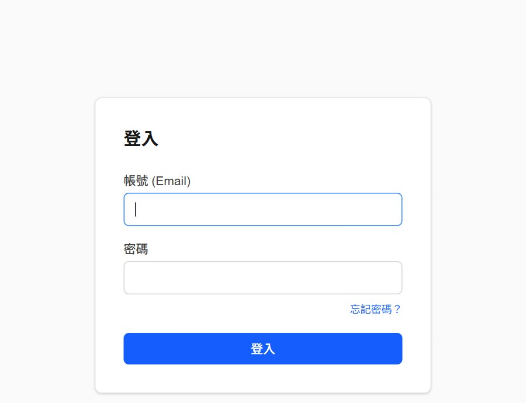

- 連續輸入錯誤 **5 次**,帳號會鎖 **15 分鐘**;管理者可以在「使用者管理」提早幫你解除鎖定。
- 登入狀態會保留 **7 天**,不用天天重新登入。
- 忘記密碼:點「忘記密碼?」,輸入 Email,系統會寄一封重設連結給你(需要系統已設定寄信功能)。

### 1.2 畫面總覽

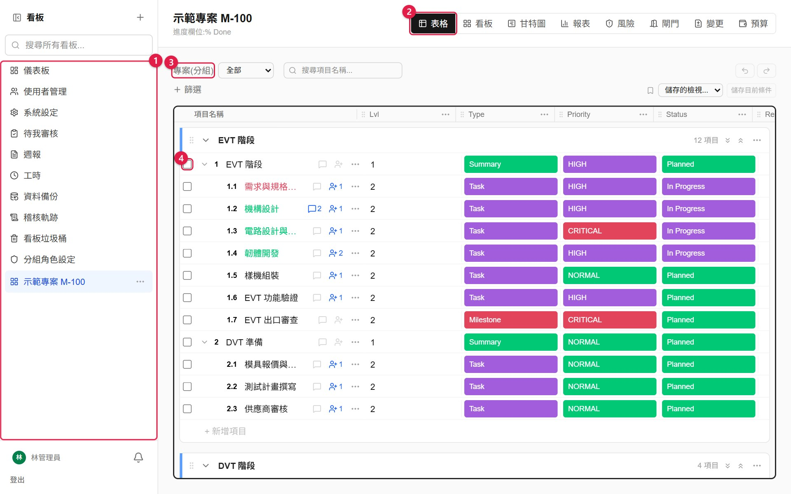

| 編號 | 位置 | 說明 |
|---|---|---|
| ① | 左側邊欄 | 儀表板、工時、週報、設定,以及你能看到的所有看板 |
| ② | 視圖切換 | 同一個看板的 8 種看法:表格、看板、甘特圖、報表、風險、閘門、變更、預算 |
| ③ | 分組篩選與搜尋 | 只看某個分組,或用名稱搜尋項目 |
| ④ | 勾選框 | 勾選項目之後,可以批次修改、複製、移動、取代名稱、刪除 |

### 1.3 側邊欄

側邊欄會依你的角色顯示不同的項目(見第 2 章)。

| 項目 | 誰看得到 | 用途 |
|---|---|---|
| 搜尋所有看板 | 全員 | 搜尋工作項、留言、附件檔名、風險與問題 |
| 儀表板 | 全員 | 個人與團隊的工作量、逾期清單 |
| 系統設定 | 全員(管理者看到全部,其他人只有看板分享設定) | 全公司的設定;底下有兩個子項目: |
| 　└ 使用者管理 | 管理者 | 新增 / 編輯帳號、休假、資源、每個人的組織單位 |
| 　└ 組織架構圖 | 全員(只有管理者能編輯) | 部門成樹,誰是誰的直屬、二階、三階主管(見 21.1b) |
| 待我審核 | 有部屬的主管、管理者 | 核准工時與請假 |
| 週報 | 全員 | 每週自動產生的進度週報 |
| 更新記錄 | 全員 | 你看得到的所有看板上,所有人對工作項的更新與變化(見 1.6) |
| 對話 | 全員 | 看板頻道、私訊、群組聊天室,訊息即時送達(見 1.7) |
| 工時 | 全員 | 登記與統計工時 |
| 資料備份 | 全員(匯入限管理者) | 每個看板匯出 / 匯入 CSV |
| 稽核軌跡 | 管理者 | 誰在什麼時候改了什麼 |
| 看板垃圾桶 | 主管以上 | 還原被刪除的看板 |
| 分組角色設定 | 管理者 | 指定每個分組的 Team Leader、DM 等 |
| 專案群組 | 有群組時 | 把同一專案的幾個看板放在一起看 |
| 看板列表 | 全員 | 你能開啟的看板;主管以上可用「+」新增 |

「系統設定」右邊的小箭頭可以收合或展開它的子項目(人在子項目那一頁時不會被收起來)。側邊欄左上角的按鈕可以**收合**,邊緣可以**拖寬**;手機畫面會變成左上角的選單按鈕。

**專案群組與看板的順序可以自己排**:在側邊欄用滑鼠把「專案群組」或「看板」的那一列往上或往下拖,放開就存好,下次登入還是這個順序。順序是**每個人各排各的**,不影響別人;新建立的看板或群組會接在最後面。管理者代操作別人的帳號時不能改對方的順序。管理者在「系統設定」的「專案群組」清單,拖曳群組左邊的把手也能排,跟側邊欄同一份順序。

### 1.4 個人資料與外觀

點側邊欄左下角你的名字或頭像:

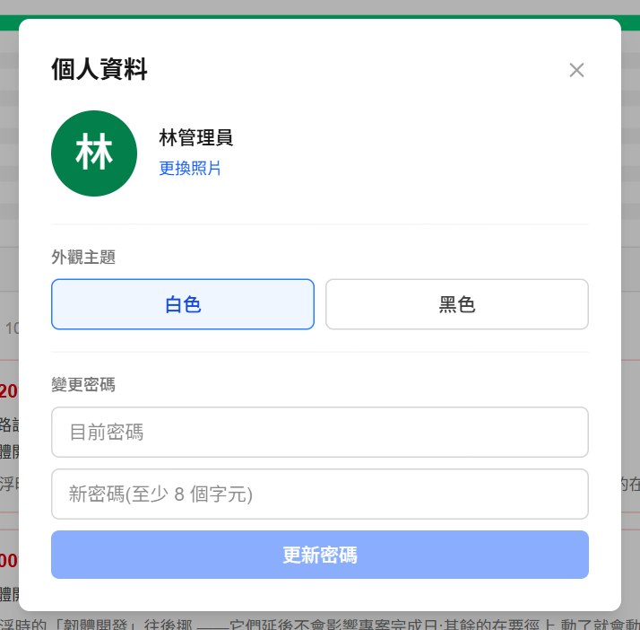

- **更換照片**:上傳頭像,畫面上各處都會用這張。
- **外觀主題**:白色或黑色。
- **變更密碼**:輸入目前密碼與新密碼(至少 8 個字元)。

**切換使用者視角(只有管理者看得到)**:要重現某位同仁遇到的問題(「為什麼我改不了這格?」「為什麼我看不到這個看板?」),不用借他的密碼——

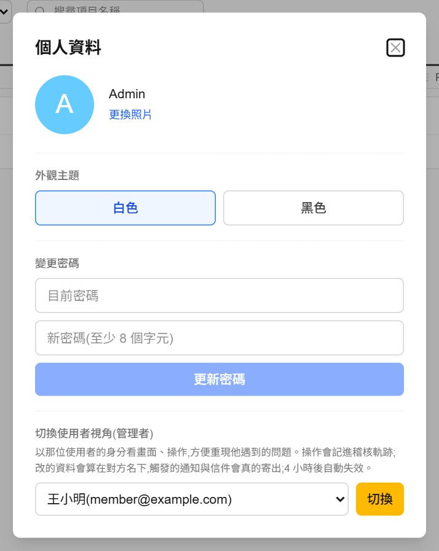

- 個人資料最下面選一位使用者(不含自己),按「**切換**」,整頁重新載入,**畫面、權限、按鈕、能做的事都跟那位使用者一模一樣**。
- 畫面最上方會有一整條黃色提示「正在以「王小明」的身分檢視(管理者 Admin 代操作)」,按「**退出**」(或個人資料裡的「退出,回到我自己」)回到自己。

- **可以實際操作**,所以要留意:
  - 改的資料(新增項目、風險、留言、工時……)**算在被檢視者名下**。
  - 觸發的通知與信件(例如被指派、核准)**會真的寄給相關的人**。
  - **稽核軌跡**會記下「開始 / 結束以某某的身分檢視」;切換期間有寫進稽核軌跡的操作,**操作者記的是管理者本人**,訊息尾端註記「〔管理者以「王小明」的身分操作〕」。留言、工時、核准這類本來就沒有稽核紀錄的資料,只會看到作者是被檢視者,**看不出是代操作**。
- **不能做**:更換對方的照片與密碼、替對方授權外部應用程式(MCP 連接器);代操作中不能再切換成第三個人,要先退出。
- **4 小時後自動失效**(要重新登入),忘了退出也不會一直掛著;按「登出」會連代操作一起結束。
- 其他人看不到這個功能;伺服器也會再確認呼叫的人在資料庫裡**現在**是管理者。

### 1.5 通知

名字旁邊的鈴鐺會顯示未讀數量。

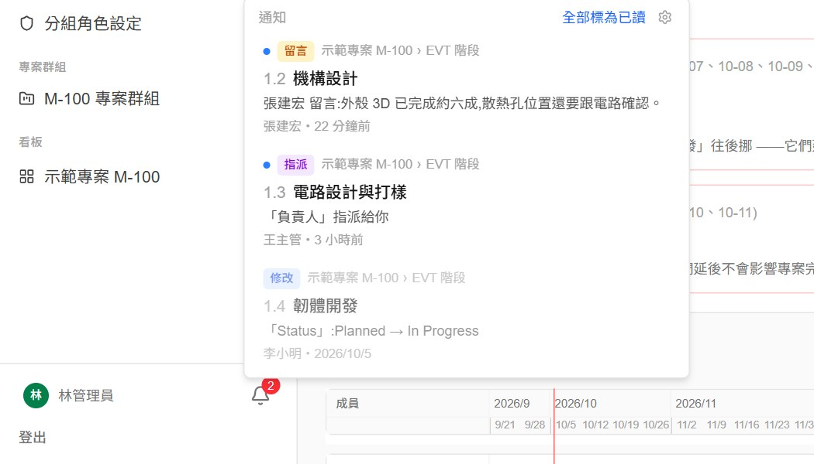

- 通知類型:**新增、刪除、修改、指派、留言、自動化、待辦事項期限提醒、對話**。點通知會直接跳到那個項目(對話的通知跳到那一間對話,見 1.7)。
- **風險 / 問題被指派**:被指派為**負責人**或**審核人**的人,鈴鐺會收到一則「指派」通知(Email 照你的通知設定),標示看板與它是風險、問題或 Mantis #編號;點下去跳到那個看板的**風險**分頁。從 Mantis 同步來的問題,Mantis 上的處理人換成你(處理人的 Email 要跟你的帳號 Email 一樣)也會通知你。自己指派自己不會通知。
- 「全部標為已讀」清掉未讀;右上的齒輪可以**設定每一種通知要不要顯示在鈴鐺、要不要另外寄 Email**。
- 管理者可以在系統設定整個關掉某些類型(全公司都不會收到),或關掉 Email 通知。

### 1.6 更新記錄頁

通知只在「被指派、被提到」那一刻提醒你。想隨時看**工作項與風險、問題**發生了什麼事,用側邊欄的「**更新記錄**」:

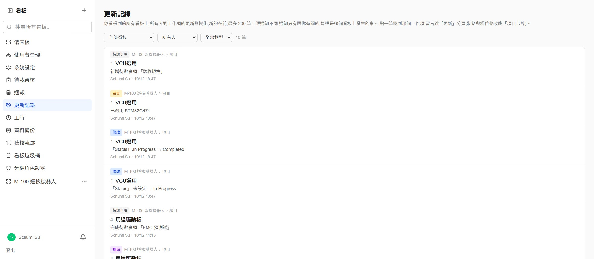

- **預設只看「與我有關」的**(以你目前登入的帳號為準):你做的、發生在**指派給你**的工作項上的、發生在你**負責或審核**的風險與問題上的。上面按「**全部**」可以看整個看板上所有人的。管理者代操作(切換使用者視角)時,看到的就是被檢視者的。
- 一筆一筆列出你**看得到的所有看板**上的更新與變化,新的在前:**工作項**的狀態切換、留言、連結、待辦事項、其他欄位修改;**風險與問題**(含 Mantis 同步來的)的**新增、指派、變更、申請結案與審核**(標籤:新增綠色、指派紫色、修改藍色)。每一筆的格式跟通知一樣:類型標籤、「看板 › 分組(風險 / 問題 / Mantis #編號)」、WBS 編號與項目名稱(風險寫標題)、改了什麼、誰・什麼時候。
- 上面三個下拉選單可以依**看板、人、類型**篩選,右邊顯示符合的筆數。
- **點一筆**:工作項**就地跳出該項目的詳細資訊**,不離開更新記錄頁、也不會跳到看板表格,停在對應的分頁——留言跳「更新」,連結、待辦事項跳各自的分頁,狀態與其他欄位修改跳「項目卡片」,並且把**改到的那個欄位**用琥珀色外框標出來、捲到畫面中間(幾秒後自己消掉)。關掉視窗就回到原本的更新記錄頁。風險與問題沒有項目詳細資訊,仍然跳到那個看板的「**風險**」分頁。
- 看得到什麼跟看板畫面一致:私人項目、「系統設定」裡 DM 的可見範圍擋掉的項目,以及已刪除(在垃圾桶)的項目,都不會出現。

### 1.7 對話

側邊欄的「**對話**」是同事之間的聊天室:訊息一送出,對方的畫面**馬上**出現,不用重新整理。左邊是對話清單,右邊是選到的那一間。

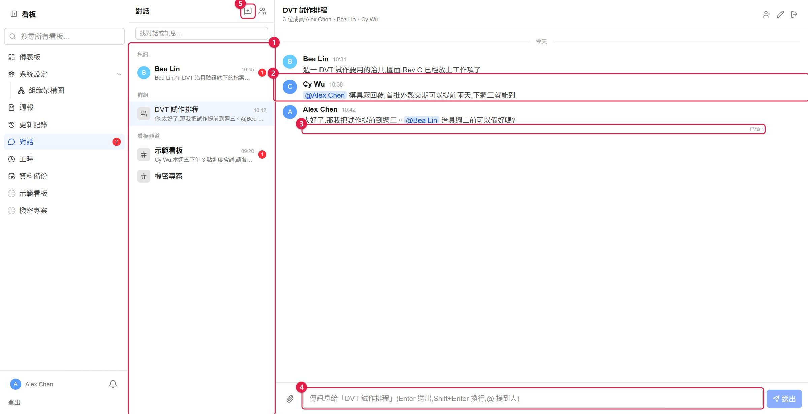

| 編號 | 位置 | 說明 |
|---|---|---|
| ① | 對話清單 | 私訊、群組、看板頻道三區;每一間顯示最後一則的摘要、時間,有未讀的亮紅色數字(側邊欄「對話」旁是全部加起來的總數) |
| ② | 訊息 | 被 @ 到的人名用藍色標出;連續同一個人在 5 分鐘內發的訊息併在一起 |
| ③ | 已讀 | 自己最後一則底下顯示對方讀到了沒(私訊「已讀」、群組「已讀 N」) |
| ④ | 輸入框 | Enter 送出;左邊的迴紋針傳檔案與圖片 |
| ⑤ | 新私訊 / 新群組 | 清單上方的兩個按鈕 |

- **看板頻道**:每個看板一間,**看得到那個看板的人**都在裡面(公開看板是所有人;受限看板是擁有者、成員、分組角色與分組成員,以及管理者)。看板的擁有者、成員、分組角色與分組成員自動算在頻道裡,有新訊息會亮未讀;公開看板的其他人要自己打開過那一間,才開始計未讀。看板進了垃圾桶,頻道就一起關起來,還原後恢復。
- **私訊**:一對一。按清單上方的「**新私訊**」,挑一個人(全公司任何人都可以);同一對人永遠是同一間。對方還沒收到任何訊息、你也沒發過的空私訊,不會出現在對方的清單。
- **群組**:按「**新群組**」,取名字、挑成員(你自動加入)。群組裡的人可以**加成員**、**改名**、**離開**;最後一個人離開,群組連同訊息就消失。
- **發訊息**:Enter 送出,Shift+Enter 換行(中文輸入法選字時按 Enter 不會送出)。一則最多 4000 字。
- **@ 提到人**:輸入 @ 會跳出人名選單,↑↓ 選、Enter 或 Tab 帶入。群組只能 @ 群組成員;看板頻道可以 @ 任何人,但**看不到那個看板的人不會收到通知**。
- **未讀**:清單上每一間顯示未讀數,側邊欄「對話」旁顯示總數。打開那一間、而且分頁在前景時,算讀到最新;分頁在背景時來的訊息會留成未讀,切回來才算讀到。
- **已讀**:私訊在你最後一則底下顯示「**已讀**」;群組顯示「**已讀 N**」(讀到的人數)。看板頻道人多,不顯示。
- **傳檔案與圖片**:按輸入框左邊的**迴紋針**挑檔案,或把檔案**直接拖進對話視窗**、或在輸入框**貼上截圖**(Ctrl+V)。送出前會列在輸入框上方,可以按 ✕ 移除;一則訊息最多 **10 個檔案**、每個最多 **25MB**(更大的請貼雲端硬碟連結)。只傳檔案不打字也可以。**圖片**(PNG、JPG、GIF、WebP)直接顯示在訊息裡,點一下用新分頁看原圖;**其他檔案**(含 SVG)顯示成檔名與大小,點了是下載。檔案只有看得到那間對話的人拿得到,沒登入或不在那間對話裡的人,即使有網址也是「找不到檔案」。
- **搜尋**:清單上方的搜尋框,輸入就即時篩對話名稱;**打兩個字以上**,還會搜你看得到的所有對話裡的**訊息內容**(私訊與群組是你在的、看板頻道是你看得到的看板;收回的訊息不搜),結果列在清單下方「訊息」區,最多 30 筆、新的在前。點一筆會打開那間對話、**一頁頁往前載到那一則**、捲到畫面中間並用琥珀色框標幾秒。
- **轉成待辦事項 / 留言**:滑鼠移到一則有文字的訊息,右邊有兩個圖示——「**轉成待辦事項**」與「**轉成工作項留言**」。跳出視窗讓你(先改一下文字、)輸入工作項名稱搜尋、選定要加到哪個工作項;待辦事項還能順便設**期限**。按下去就跟你在項目視窗手動新增一模一樣(權限、活動紀錄、通知都照常;你得有那個看板的權限,看不到的私人項目搜不到)。討論出結論時用它,不用複製貼上。

  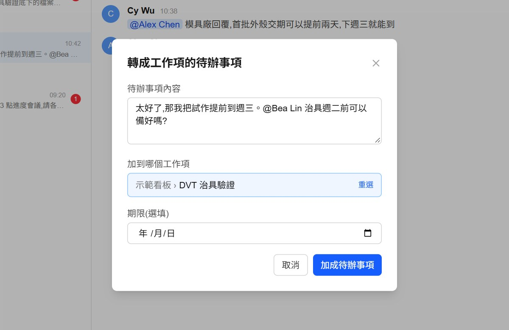
- **收回**:滑鼠移到自己的訊息,按右邊的垃圾桶圖示。訊息的位置還在,內容換成「訊息已收回」,所有人都看不到原文,**附的檔案也會一起刪掉**。只能收回自己的。
- **通知**:被 @ 到一定通知;私訊與群組有新訊息也通知,但**同一段未讀只通知第一次**(你還沒看之前,對方再傳十則也不會再通知);看板頻道只通知被 @ 到的人。通知出現在鈴鐺(標籤「對話」,點下去直接進那一間)並照通知設定寄 Email;每個人可以在鈴鐺的齒輪裡關掉「對話」這一類的站內或 Email 通知,管理者也能在系統設定整個關掉。打開那一間時,它的通知自動標成已讀。
- **隱私**:私訊與群組只有成員看得到,其他人拿到網址也進不去;管理者**也看不到**別人的私訊。管理者「**切換使用者視角**」(代操作,見 1.4)時**不能使用對話**——發出去的訊息會變成對方說的話,私訊內容也不該讓代操作的人看到。
- 訊息與檔案會一直保留,沒有自動刪除舊的。管理者刪除某個帳號時,他發過的對話訊息會一起刪掉;群組最後一個人離開時,群組的訊息與檔案一起消失。
- **工作項的留言也是即時的**:兩個人同時開著同一個工作項的「更新」分頁,一個人留言,另一個人的畫面馬上多一則,不用關掉重開;打到一半的字不會被洗掉。看不到那個看板的人不會收到。(留言本身的功能——@ 提到、彙整進週報——見第 5 章,沒有改變。)
- 如果公司網路或代理伺服器擋掉即時推送,對話清單會改成每 15 秒自動更新一次,功能照用,只是慢一點。

---

## 2. 角色與權限

帳號分三種角色,由管理者在「使用者管理」設定:

| | 管理者 | 主管 | 團隊成員 |
|---|---|---|---|
| 看到的選單 | 全部 | 少了使用者管理(系統設定底下)、稽核軌跡、分組角色設定 | 只有儀表板、系統設定(看板分享設定、組織架構圖)、週報、工時、資料備份 |
| 新增看板 | ✓ | ✓ | |
| 新增 / 插入 / 改名 / 搬移 / 複製項目 | ✓ | ✓ | |
| 改任何儲存格 | ✓ | ✓ | 只能改**自己被指派的項目**的「狀態」與進度欄位 |
| 改日期、天數、拖甘特長條 | ✓ | 自己建立的項目 | 不行 |
| 刪除項目 | ✓ | 自己建立的項目 | 不行 |
| 匯入 / 匯出 / Resource 對應 | ✓ | | |
| 自動化、專案範本、垃圾桶 | ✓ | ✓ | |
| 看板重新命名 / 刪除 | ✓ | 自己建立的看板 | |

<table>
<tr>
<td align="center"></td>
<td align="center"></td>
<td align="center"></td>
</tr>
<tr>
<td align="center">團隊成員</td>
<td align="center">主管</td>
<td align="center">管理者</td>
</tr>
</table>

### 看板的存取範圍

每個看板可以設成**公開**(所有登入的人都能開)或**限制存取**(只有擁有者、管理者與被指定的成員)。限制存取的看板標題旁會有「限制存取」標籤。在「系統設定 → 看板分享設定」調整;看板擁有者可以調整自己的看板。

被指定為某分組任何角色(Team Leader、DM、QA…)或實作成員的人,不用另外加進名單也一定看得到該看板。

### 分組角色【管理者設定】

某個分組的負責人,可以在**那個分組**內擁有額外的權限,不需要升成主管。在側邊欄「分組角色設定」選看板與分組,按「設定角色」:

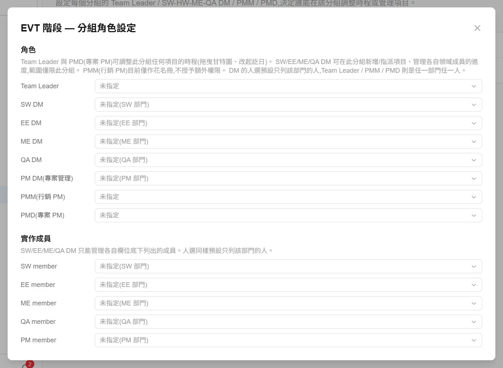

| 角色 | 權限(僅限這個分組) |
|---|---|
| Team Leader、PMD(專案 PM) | 調整此分組任何項目的時程(拖甘特圖、改起訖日);新增 / 指派項目 |
| SW / EE / ME / QA / PM DM | 在此分組新增、指派項目,並管理自己部門成員的進度 |
| PMM(行銷 PM) | 目前只是名冊,不授予額外權限 |
| 實作成員 | 供各部門 DM 管理範圍使用(DM 只能管理自己部門名單內的人) |

DM 的人選預設只列該部門的人(部門在「使用者管理」的「單位」欄設定);Team Leader、PMM、PMD 可以是任何人。

**DM 的可見範圍【管理者設定】**:預設 DM 跟其他成員一樣看得到整塊看板。要讓某個職能的 DM **只看得到跟自己職能相關的內容**,到「系統設定」的「**DM 的可見範圍**」,在那個職能的那一列勾選(每個勾選當下就存,三項各自開關,預設都不勾):

| 勾選項目 | 被限制的 DM 看到什麼 |
|---|---|
| 工作項 | 只看得到**指派給自己與同職能組員**的工作項,加上它們的**上層項目**(這樣在階層裡才找得到位置);沒有指派任何人的項目不算相關,看不到(自己建立的除外)。表格、看板、甘特圖、儀表板、搜尋、匯出 CSV 與 MCP 都照這個範圍 |
| 人力表與人力規劃彙總 | 只看得到**同職能單位**的名額、人月與欄位(SW DM 只看 SW;HW DM 看 EE 與 HW),合計也只算這些單位 |
| 預算金額 | 看不到階段預算、NRE 報價單、樣機 BOM 的金額(那幾個分頁不顯示)。人力表上的金額跟著「人力表」那一項,不受這一項影響 |

- 「同職能組員」指「分組角色設定」裡那個職能的組員名單;被限制的 DM 在同一塊看板上看到的範圍,是**自己所有職能**的聯集——同時是 SW DM 與 HW DM 的人,**兩個職能都勾了**那一項才限制。
- **不受影響**:管理者、看板建立者、Team Leader、PMD(身兼這些的 DM 不受限)。
- 這只是縮小「看得到」的範圍;DM 本來能做的事(新增、指派項目、編輯自己單位的名額)不變。私人項目的規則仍然照舊,兩個規則疊加,只會更少、不會更多。
- 這個設定不影響排程計算:看不到的項目照樣參與日期推算,只是不顯示。
- **沒涵蓋的地方**:系統定時寄出的週報 Email 是以系統身分產生的,不套用這個限制;匯出甘特圖 Excel 帶的是整個看板與預算,所以被限制的 DM 不能匯出;項目卡片「工時與費用」分頁裡的費用不算在「預算金額」裡。

### 私人項目與私人分組

分組或單一項目可以設成**私人**:只有指定的人、建立者、被指派到的人與管理者看得到。分組標題或項目列的「…」選單 → **可見範圍**。私人項目名稱旁會有鎖頭圖示;私人項目的子項目一起隱藏。只有建立者或管理者能改這個設定。

---

## 3. 看板的基本概念

**看板 → 分組 → 工作項(可以一層一層往下)**

- **看板**:一個專案或一個團隊的工作清單。
- **分組**:看板裡的大段落,例如「EVT 階段」「DVT 階段」。每個分組各自從 1 開始編號。
- **工作項**:一筆工作,可以有**子項目**,形成階層。編號會自動依階層與順序產生,稱為 **WBS 編號**(例如 1.2.3),畫面上項目名稱前面那個數字。
- 新增子項目時,上一層會**自動變成 Summary(摘要)**;它的起訖日期由底下子項目統計出來。底下的子項目全部刪光,會還原成原本的 Type。

### 預設欄位

新看板預設有這些欄位(管理者可以在系統設定改預設,也可以在每個看板新增或刪除欄位):

| 欄位 | 類型 | 用途 |
|---|---|---|
| Lvl | 數字 | 階層數字,會依位置自動維護 |
| Type | 狀態 | **Task**(一般工作)、**Summary**(摘要,由子項統計)、**Milestone**(里程碑,時間固定為一天) |
| Priority | 狀態 | CRITICAL / HIGH / NORMAL |
| Status | 狀態 | Planned / In Progress / Completed |
| Resource | 文字 | 負責的資源名稱 |
| Pred | 文字 | 前置依賴:這個工作要等誰做完(或開始)才能做 |
| Link | 狀態 | 前置的關聯類型:FS / FF / SS / SF |
| Lag | 數字 | 前置之間要空幾天(負數代表提前) |
| Comment | 文字 | 備註 |
| Start / Days / Finish | 日期 / 數字 / 日期 | 開始日、天數、結束日 |
| % Done | 數字 | 完成百分比(進度欄位) |

> **有子項目的項目,進度是子項目的平均**(沒填的子項目算 0%),不是它自己填的數字——表格、項目卡片、儀表板都一樣,只顯示、不能直接輸入。要改請到子項目填進度。沒有子項目的項目才能直接輸入。

欄位類型有五種:**文字、狀態、人員、日期、數字**。表格最右邊欄位標題列的「+」新增欄位;欄位標題的「…」可以**設為進度欄位**或**刪除欄位**;拖曳欄位標題可以調整順序,拖曳項目名稱欄的邊界可以調整寬度。**項目名稱欄(表格與甘特圖都一樣)一打開就會依名稱的字數調成看得到全名的寬度**——連收合著的子項目、縮排與 WBS 編號都算進去;名稱太長時最寬停在畫面寬度的一半(最多 720 像素),不會把資料欄或時間軸擠沒,更長的再自己拖寬。

> 刪除欄位是永久的。Lvl、Type、Pred、Link、Start、Days、Finish 等欄位會被排程計算用到,請不要刪除。

**表格最右邊三個自動記錄的欄位**(唯讀,不能編輯、也不能刪除)——橫向捲到最右邊就看得到:

| 欄位 | 內容 |
|---|---|
| 進行中時間 | 最近一次把「狀態」切成 **In Progress / 進行中** 的時間 |
| 完成時間 | 最近一次把「狀態」切成 **Completed / 完成** 的時間;再切回別的狀態就清掉 |
| 更新記錄 | 這個工作項**最近一筆更新或變化**,寫法跟名字旁邊鈴鐺的通知(見 1.5)一樣:一個類型標籤(**修改**藍色、**指派**紫色、**留言**黃色,連結與待辦事項是灰色)、改了什麼,下面一行是「誰・什麼時候」 |

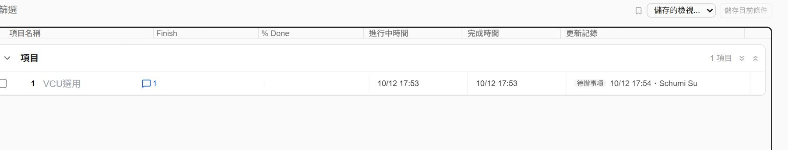

**「使用樣機」欄**(可以編輯,排在這三個自動記錄欄位的前面):這個工作項(例如測試項目)用到**樣機計畫排出來的哪幾台樣機**。點一下開選單,依「產品 / 階段」分組勾要用的樣機(可以搜尋),**關掉選單時存檔**;格子顯示第一台的名字,多台寫「等 N 台」,滑鼠停上去看全部。樣機計畫(預算 → 樣機計畫)還沒排台數的看板,這一欄是空的。誰能改:管理者、主管,或被指派到這個工作項的人;其他人只看得到。樣機從哪來、台數改了會怎樣,見「預算 → 樣機計畫」。

- **點「更新記錄」跳出對應的項目**:是「留言」就直接跳到項目視窗的「**更新**」分頁;「連結」跳「連結」、「待辦事項」跳「待辦事項」;狀態切換與其他欄位修改跳「**項目卡片**」。點「進行中時間」「完成時間」也是跳項目卡片。
- **看這個工作項所有的更新與變化**:左邊「項目名稱」那一欄,每個項目的名稱右邊有一顆時鐘圖示(滑鼠停上去寫「更新記錄」)。點下去跳出「**更新記錄:項目名稱**」視窗,新的在前,最多 100 筆,格式跟表格那一欄一樣;點其中一筆,視窗會關掉並打開這個項目,停在對應的分頁(規則同上)。

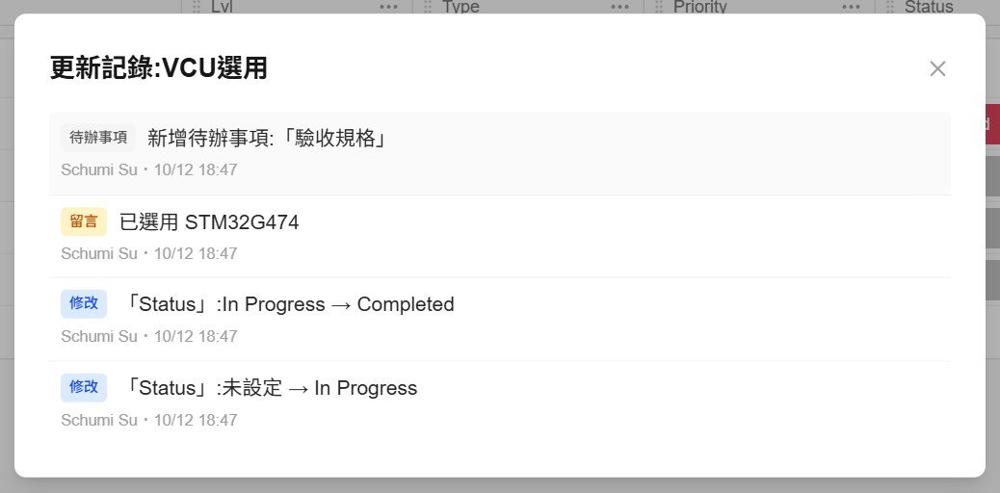

- **看整個看板上發生的事**:側邊欄的「**更新記錄**」頁,見 1.6。
- 時間記的是**狀態欄**(名叫 Status 的那一欄,沒有就第一個狀態欄)切換的當下,台灣時間;完成、進行中的判斷看狀態選項的名稱(Completed / Done / 完成 / 已完成;In Progress / 進行中 / 實作中 / 處理中)或看板「報表設定」裡指定的完成選項。
- 以前已經發生的切換也補進來了(從舊的活動紀錄的文字認出來);認不出來的、不是靠狀態欄完成的,這兩欄是空白。

---

## 4. 表格視圖

### 4.1 新增與整理項目

- **新增項目**:分組底下的「+ 新增項目」輸入名稱後按 Enter。
- **新增子項目 / 在上方或下方插入**:項目列右邊的「…」選單。

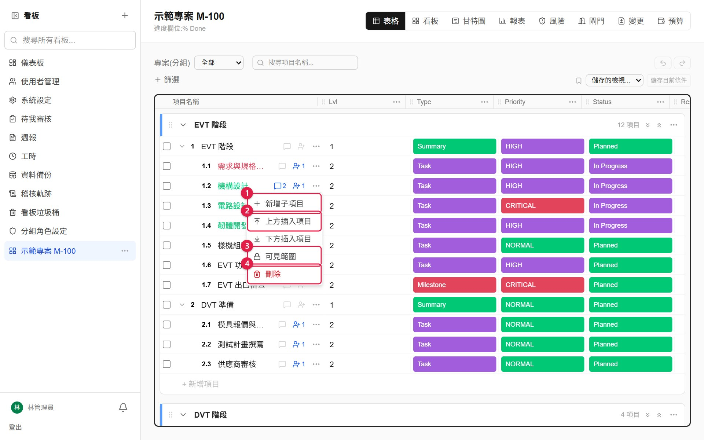

| 編號 | 功能 |
|---|---|
| ① 新增子項目 | 在這個項目底下加一個子項目 |
| ② 上方插入項目 | 在這個項目前面插入同階的新項目 |
| ③ 可見範圍 | 設成私人項目 |
| ④ 刪除 | 移到垃圾桶(可還原) |

- **新增分組**:表格最底下的「+ 新增分組」;分組標題可以直接改名,標題左邊的把手可以拖曳調整順序;分組標題右邊的雙箭頭可以把整個分組**全部展開 / 全部收合**。
- **名稱旁的小圖示**:留言數、指派的人數(點開可以直接分配)。

### 4.2 直接編輯儲存格

直接點儲存格就能改:

- 文字、數字:輸入後按 **Enter** 或點旁邊就會儲存。
- 日期:點選日期欄位。
- 狀態、人員:從下拉選單選。**人員**與**工作項**的下拉選單(例如工時登記的專案工作項、批次設定負責人、甘特圖的父項目篩選)最上面都有搜尋框,輸入關鍵字就會即時過濾,可以用空白隔開多個關鍵字(例如「AMR poc-3」),按 Enter 選第一個符合的(見 9.6)。
- **灰底的日期欄位**是被鎖住的,表示它由前置依賴或子項目統計算出來,不能手動改(游標移上去會說明原因)。要改請改它的「天數」、「前置依賴」或子項目。

#### 貼上(Ctrl+V):一次新增很多項目、或整欄取代

從 Excel、Google 試算表複製一段儲存格,可以直接貼進表格,不必一格一格打。

**新增很多項目**:複製一欄(或好幾欄)內容,點分組底下的「+ 新增項目」,按 **Ctrl+V**。

- 每一列建一個項目,放在這個分組的最上層。**第一欄是項目名稱**;名稱是空的那一列不會建。
- 如果複製的是**多欄**,第 2、3… 欄會**依序對應到表格由左到右的欄位**(第 2 欄對應表格第 1 個欄位,依此類推)。貼上前會先跳出視窗,**列出每一欄對應到哪個欄位、哪些格子轉不過去**,按「建立」才會真的建。
- 各欄位的格式:狀態欄貼選項的名稱(不分大小寫);負責人欄貼姓名或 Email;日期欄貼 2026-10-08 或 2026/10/8;進度欄貼 50 或 50%;數字與文字欄照貼。轉不過去的格子會留空,項目照建。
- **Pred(前置依賴)與 Lvl 這兩欄不能貼**——Pred 存的是工作項的關係、Lvl 由項目的位置自動維護,貼上時會自動略過。
- 一次最多 300 列;一批一批建立,輸入框會顯示進度。

**整欄取代已存在的資料**:先**框選同一欄的一段儲存格**,再按 **Ctrl+V**。

1. 框選:在某一欄的儲存格上**往上或往下拖曳**,或先點一格、再按住 **Shift** 點另一格。框到的格子會變淡藍,畫面底下顯示「已框選 N 格」。(單純點一下仍然是進去編輯;按 Esc 或點別處可以取消框選。)
2. 按 Ctrl+V:跳出視窗說明會換成什麼,按「貼上」才會寫入。框選的格子**由上到下**對應貼上的**每一行**;只貼一行的話,框選的每一格都填同樣的值。行數跟格數不一樣時,取較少的那邊,其餘的不動,並說明。
3. 權限與鎖定照原本的規則:你沒有權限改的格子、被前置依賴鎖住的日期、有子項目的進度,都會略過並說明原因,不影響其他格。
4. 貼上之後可以按看板的「**上一步**」復原整批。(用貼上新增的項目不在上一步裡,要刪請用刪除。)

注意:這跟一格一格手動改一樣,**會通知被指派的人、套用自動化規則**;框選取代只取複製內容的第一欄,項目名稱要批次改請用「取代名稱」。

### 4.3 拖曳:重新排列與改階層

按住項目列的**空白處**(不是名稱或按鈕)往上下拖曳,放開時依位置決定結果,**拖曳途中就會看到放開後的新 WBS 編號**:

| 放開的位置 | 結果 |
|---|---|
| 目標列的上半部(中間) | 成為目標的**子項目** |
| 目標列的下緣 | 變成目標的**同階**項目(放在它後面) |
| 目標列的下緣、而且滑鼠往左偏 | **外移一層**,變成目標父項的同階項目 |

規則:只能在**同一個分組**內拖曳;不能拖進自己的子孫底下。需要結構權限(管理者、主管、或該分組的負責角色)。搬移後會自動重新編號,Lvl 與 Summary 狀態也會一起處理。

**不想拖曳時,用升階 / 降階**(表格與甘特圖都有):

| 做法 | 結果 |
|---|---|
| 滑過項目列,按名稱旁的 **降階**(→)小按鈕;或項目的「…」選單 → 降階;或在名稱上按 **Tab** | 變成**上一個同階項目的最後一個子項**,它自己的子項目跟著走;下面的同階項目編號往前補 |
| 按 **升階**(←)小按鈕;或「…」選單 → 升階;或在名稱上按 **Shift+Tab** | **提升一階**,變成父項的同階項目、緊接在父項後面;**原本排在它後面的同階項目變成它的子項**(接在它原本的子項後面) |

例子(這一組本來是 1.1 底下的 1.1.14 ~ 1.1.18):
- **升階 1.1.16**:它變成 **1.2**(1.1 的下一個同階項目),原本的 1.1.17、1.1.18 變成它的子項 **1.2.1、1.2.2**;原本的 1.2 往後變 1.3。**清單上的位置不動**,只有階層變了——不會跑到原本下面那幾個的後面。
- **降階 1.1.16**:它變成 **1.1.15.1**(1.1.15 的子項),下面的 1.1.17 編號往前補成 1.1.16。
- 排在最後一個的項目升階,下面沒有人可以接管,就只是變成父項的下一個同階項目。

- 第一個同階項目前面沒有誰可以當父項,所以沒有降階;最上層的項目沒有升階。做不到的那個方向不會出現。
- 升階接管了子項,它就變成 Summary(跟其他有子項的項目一樣);「上一步」會連同接管來的子項一起放回去,它的類型也還原。用拖曳「往左拖外移一層」不接管下面的項目(那是你自己指定放在哪)。
- 降階進一個收合的父項時,它會自動展開。用鍵盤 Tab / Shift+Tab 搬完,游標還停在這個項目上,可以連續按。
- 效果跟拖曳完全一樣:WBS 編號、Lvl、Summary 狀態會一起處理,也能用「上一步 / 下一步」復原。需要的權限也跟拖曳一樣。

### 4.4 篩選與儲存的檢視

按「+ 篩選」新增一個條件,可以疊加多個:

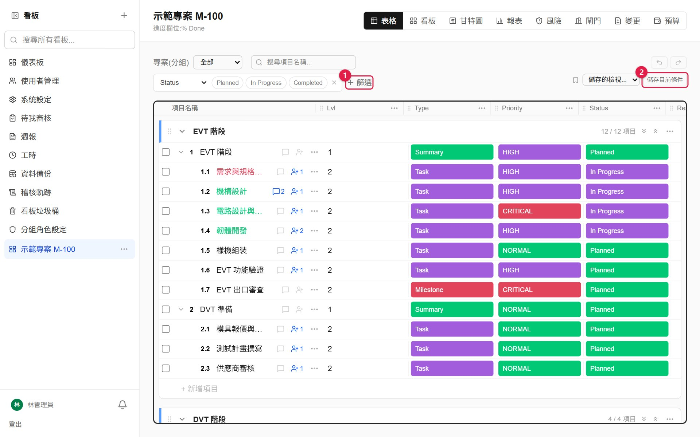

- 依欄位類型提供不同的篩選:文字(包含)、狀態(選項)、人員、日期(區間;可選「今天」,存成檢視後每天自動跟著今天走)、數字(最小–最大)。
- 另外還有兩個特殊條件:**任務分派者**、**任務新增時間**。
- 設好條件後按「儲存目前條件」,取名後存成**檢視**;可以勾選「共用給看板成員」。之後從「儲存的檢視…」下拉選單切換。
- 篩選條件在表格與甘特圖各自獨立,但儲存的檢視兩邊都能套用。

---

## 5. 項目卡片

點項目名稱,會打開這個項目的卡片,上面有七個分頁:

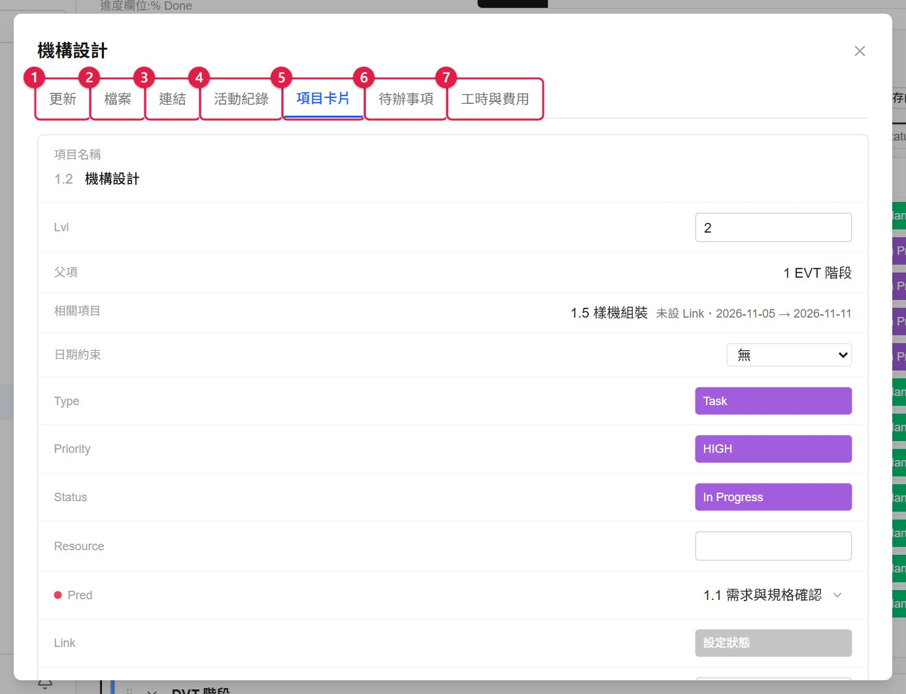

| 分頁 | 內容 |
|---|---|
| ① 更新 | 留言討論,輸入 **@** 可以提及成員(他會收到通知) |
| ② 檔案 | 上傳這個項目的檔案 |
| ③ 連結 | 貼上雲端硬碟、Google Sheet、外部文件的網址,可以取顯示名稱 |
| ④ 活動紀錄 | 這個項目所有被修改的歷史:誰、什麼時候、改了什麼;最上面是任務派遣人與派遣時間 |
| ⑤ 項目卡片 | 所有欄位、父項、相關項目、日期約束、浮時、基準線、人員分配 |
| ⑥ 待辦事項 | 這個項目底下的小清單,可以勾選完成 |
| ⑦ 工時與費用 | 直接費用與實際工時 |

**更新分頁**:

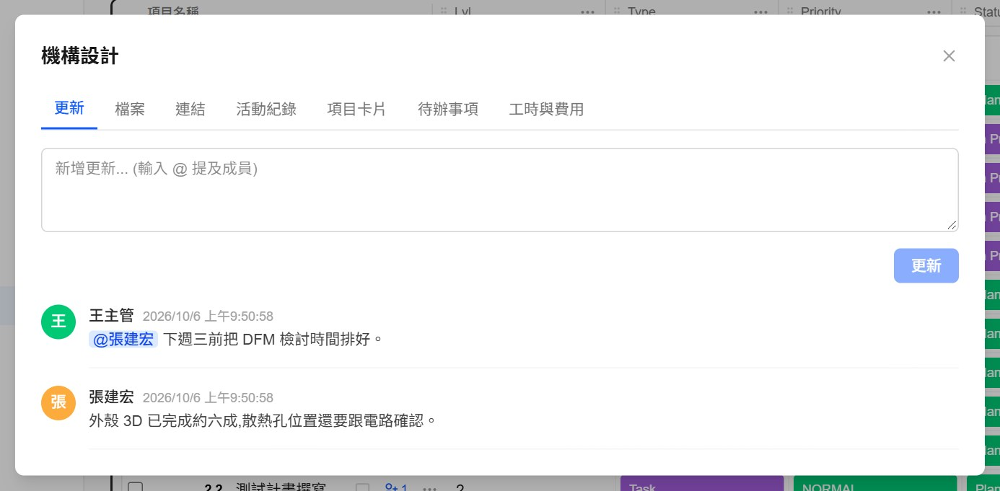

**待辦事項分頁**:

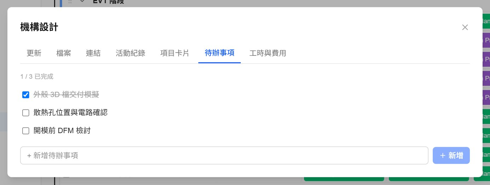

- **每一筆待辦事項可以設期限(DEADLINE)**:新增時在輸入框旁的「**期限**」選日期(選填);已經有的,滑鼠移到那一列、點日曆圖示也能補上。有期限的那一列會顯示「**10/28・明天到期**」,依遠近上色——**逾期紅、今天到期橘、明天到期黃、其餘灰**;點日期可以改,旁邊的 ✕ 清除。完成的待辦事項只留日期、不再標顏色。期限是**台北的日曆日**,「今天到期」是今天過完之前。
- **到期前會提醒**:還沒完成的待辦事項,系統在**到期前一天、當天、逾期之後各提醒一次**(不是天天催),在台北**早上 9 點之後**送出,時間點太晚才設的會在下一輪檢查(每 5 分鐘一次)馬上補上。改了期限就重新計算——延後的會重新提醒,標成完成的不再提醒。
- **提醒給誰**:這個工作項目的**負責人**(負責人欄位與人員分配)加上**新增這筆待辦事項的人**;不含看板擁有者。通知類型是「**待辦事項期限提醒**」,鈴鐺的標籤是橘色「期限」,Email 也會寄(預設開;右上齒輪可以各自關掉,管理者也可以在系統設定的「通知類型」整個關掉)。

**工時與費用分頁**:

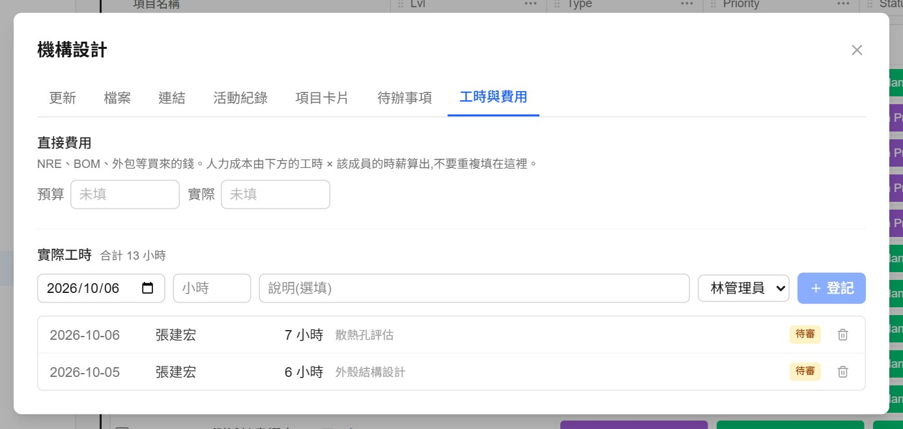

- **直接費用**:預算與實際金額,記錄買來的錢(NRE、BOM、外包)。人力成本不要填在這裡,它由工時 × 成員時薪自動算出。
- **實際工時**:選日期、輸入小時、說明(選填)後按「登記」。新登記的工時是「**待審**」,要等直屬主管核准後才會計入成本報表。

### 項目卡片分頁裡值得注意的欄位

- **Status 的切換時間**:卡片上 **Status 那一列的下面**有一行小字,寫**什麼時候切成進行中、什麼時候切成完成**(台灣時間,後面是誰切的),例如「切成進行中:10/12 18:47・Schumi Su」「切成完成:10/13 09:10・Schumi Su」。還沒切過寫「尚未」;狀態改了這一行會跟著更新。**完成要現在還是完成狀態才顯示**——完成後又切回別的狀態,會寫「目前不是完成(曾於 … 完成)」。進行中顯示的是**最近一次**切成進行中的時間。這跟表格最右邊的「進行中時間」「完成時間」是同一份紀錄;每一次切換的完整歷史在「活動紀錄」分頁。
- **相關項目**:列出誰以這個項目為前置(也就是排在它後面的工作)。
- **日期約束**:替項目加上一條日期規則。
  - 不得早於(開始):前置算出的開始日若早於這天,會被推到這天。
  - 不得晚於(完成):是**期限**,不會改動排程,只在超過時提出警告。
  - 必須完成於:完成日固定在這天,開始日由**天數**往回推算。**不需要前置依賴、也不需要手動開始日**,只要有天數,Start / Finish 就會算出來(自動排程的看板連 Days 也會寫上),甘特圖畫出一條「到這天結束」的條。例如「必須完成於 11/03」、天數 23,開始日就是 10/12。
    - 這種項目的 **Start / Finish 是算出來的,不能手改**(表格、項目卡片、甘特條都一樣),滑過或點一下會說明原因;要調整請改**約束日期**或**天數**。
    - 還沒填天數時日期是空的,約束那一列會提示「還沒有天數」,補上天數就會算出來。
    - 同時有前置依賴時,以約束為準:完成日固定在約束日,不會被前置依賴推走。
    - **跟前置依賴打架會警示**:前置依賴最快要排到的完成日,晚於約束日時(例如前置到 11/05 才做完,約束卻要求 11/03 完成),項目仍然排在約束日——也就是會在前置還沒做完時就開始。這時:
      - 存下約束、或改了天數 / Pred / Link / Lag 讓它變成這樣的當下,會跳出「**日期約束衝突**」視窗,寫出前置依賴最快的日期、目前實際排的日期;**改前置那一端**(例如把前置拉長)害後面某個被釘住的項目排不下時,改的人也會看到,並指名是哪個項目。
      - 項目卡片的約束那一列會一直標**紅字**說明,直到你調整約束日期、天數或前置依賴為止。
      - **在甘特圖上拖曳**(整條搬移、拉開始 / 結束邊緣)或**拉前置連結**時,確認視窗會先列出「⚠ 套用後,以下 N 個項目的『必須完成於』會跟前置依賴衝突」——把前置往後拖,害後面被釘住的項目排不下,在你按「確定」之前就看得到,不用等到套用之後。只列這次調整**新造成或變嚴重**的,原本就有的衝突不重複列;列出來只是警告,不會擋你。
      - 前置依賴排出來比約束早,只是有餘裕,不警示。批次修改、匯入、人員分配視窗造成的衝突不會跳視窗,但打開項目卡片仍看得到紅字。
- **總浮時 / 要徑**:這個項目最多可以延幾天而不影響整個專案;0 天代表在要徑上。
- **基準線**:與原始計畫相比延遲或提前幾天(建立基準線後才會出現)。
- **人員分配**:指派人員與投入百分比,會換算成工時與成本。
- **任務派遣人**與**任務派遣時間**:誰建立了這個項目、什麼時候建立(派遣)的——台灣時間、含年份,例如「2026/9/24 10:30」。「活動紀錄」分頁的最上面也寫著派遣人與派遣時間,就算這個項目還沒有任何修改紀錄也看得到。

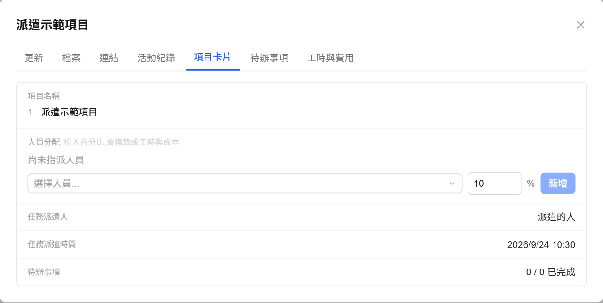

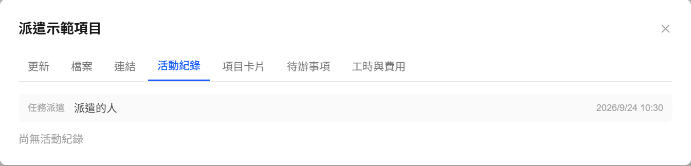

---

## 6. 上一步 / 下一步

改錯了不必手動一個一個改回來。表格與甘特圖工具列都有兩顆按鈕:

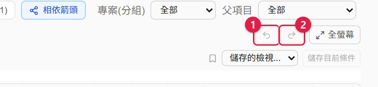

- **上一步**(復原)、**下一步**(重做)。按鈕停用(灰色)代表沒有可以復原的紀錄。滑鼠停在按鈕上會顯示是哪一個動作。
- 快捷鍵:**Ctrl + Z**(Mac 用 ⌘ + Z)上一步;**Ctrl + Y** 或 **Ctrl + Shift + Z** 下一步。游標在輸入框裡、或對話框開著時,快捷鍵不會觸發(輸入框自己的文字復原照常運作)。
- 三個視圖(表格、看板、甘特圖)**共用同一份紀錄**,切換視圖不會掉;最多保留 **50 步**。

**可以復原的動作**

| 類型 | 說明 |
|---|---|
| 儲存格修改 | 文字、數字、日期、人員、狀態、Pred,以及在看板視圖拖曳卡片換狀態 |
| 甘特圖日期 | 拖移整根長條、拉長或縮短長條(依賴它的項目會跟著重新排程) |
| 拖曳搬移項目 | 表格與甘特圖裡拖曳改階層或順序 |
| 項目改名 | 在項目卡片改名稱 |

**限制,請先知道**

- 紀錄只存在**這次開著的畫面**:重新整理、換看板就清空。
- 新增、刪除、批次操作(包含批次取代名稱)、人員分配(指派人員與投入 %)、分組與欄位的修改**無法復原**。刪除的項目請從垃圾桶還原。
- 復原前,系統會先確認那個值**還是你當初改完的值**。如果期間別人(或別的分頁)又改過,會跳出「無法復原」並擋下來,不會蓋掉別人的修改。
- 復原也會再發一次通知,被指派的人可能多收到一則「已更新」。若狀態改變曾觸發自動化規則,復原只會把狀態改回去,不會反轉自動化做的事。

---

## 7. 勾選後批次操作:複製、移動、取代名稱、刪除

表格與甘特圖每一列前面都有**勾選框**。勾選一個或多個項目後,上方會出現操作列:

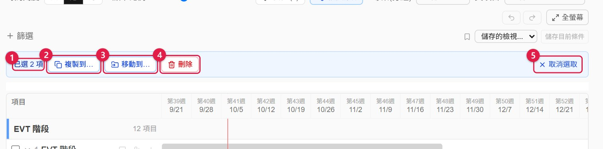

| 編號 | 功能 |
|---|---|
| ① 已選 N 項 | 括號內會標出連同子項目一共幾項 |
| ② 複製到… | 複製到指定的父項目底下 |
| ③ 移動到… | 搬到指定的父項目底下,並決定位置 |
| ④ 取代名稱… | 把勾選項目名稱裡的某個字樣,統一換成別的字樣 |
| ⑤ 刪除 | 移到垃圾桶 |
| ⑥ 取消選取 | 清除勾選 |

**重點規則**:複製、移動、刪除:勾選一個父項,它底下的**所有子項目會一起被處理**。如果父項和它的子項都被勾選,只算父項(不會複製兩份)。**取代名稱例外**,只改打勾的項目本身(見 7.3)。**父項被收成一行時**(底下的子項看不到),勾它會**連所有子項一起勾起來**,取消勾選也是整個子樹一起取消,所以取代名稱也會一起改到那些子項;父項**展開**著時只勾它自己,子項各自勾。表格視圖的操作列除了這幾個,還保留原本的批次設定狀態、人員欄位、與「推移 N 天」。表格裡的複製 / 移動 / 取代名稱 / 刪除只有管理者與主管看得到;只有分組負責角色的人(例如 Team Leader)請在**甘特圖**操作,系統會再逐個分組檢查權限。

### 7.1 複製

按「複製到…」:

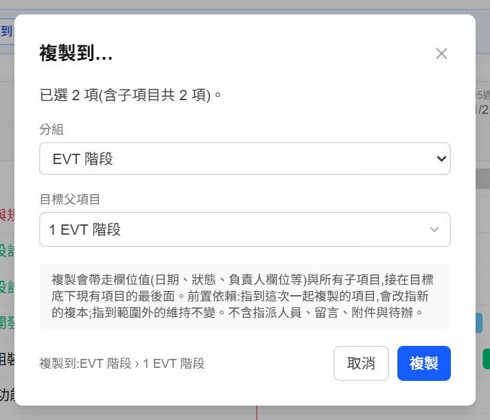

1. 選擇**看板**(預設是目前這個看板;也可以選別的看板,見 7.5),再選**分組**。
2. 選擇**目標父項目**;留空代表放在該分組最上層。同一個看板內,被選的項目與它們的子項目不能當目標。
3. 按「複製」。

複製的內容:

- 項目名稱、階層、所有**欄位值**(日期、天數、狀態、優先度、負責人欄位等);Lvl 依新位置自動調整。
- 日期約束、直接費用預算。
- **前置依賴(Pred)**:指到「這次一起複製」的項目,會改指它們的複本(複本之間的先後關係保持原樣);指到範圍外的項目維持不變(複本和原件等同一個前置)。每一條依賴自己的關聯類型與 Lag 都保留。
- 目標父項會自動變成 Summary。

**不會複製**:指派人員(人員分配)、留言、附件、連結、待辦、工時。你看不到的私人子項目也不會被複製。

複製整批在同一個交易裡完成,失敗就什麼都不會建立。複製出來的項目名稱和原件一樣。

### 7.2 移動,並決定位置

按「移動到…」:

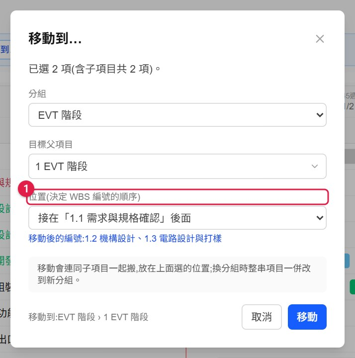

1. 選擇分組與目標父項目(同複製)。
2. **位置**(決定新的 WBS 編號順序):
   - 放在最後面(預設)
   - 放在最前面
   - 接在「某個項目」後面 —— 清單是目標底下現有的項目(扣掉被搬的)。
3. 選擇之後,視窗會即時顯示**移動後的編號**(藍字),例如「1.2 機構設計、1.3 電路設計與打樣」。
4. 按「移動」。

也可以用來在**同一個父項底下重新排序**:目標選原本的父項,再挑位置。

- 換分組時,整串子項目一起改到新分組;Lvl、Type=Summary、舊父項的順序都會一併處理。搬空的舊父項會還原成原本的 Type。
- 舊匯入留下的「WBS 編號式」前置依賴,會在跨分組搬移前先轉成固定的項目參照,不會因為搬走而指錯人。
- 搬出去的**來源分組**也需要結構權限。

### 7.3 取代名稱

按「取代名稱…」:

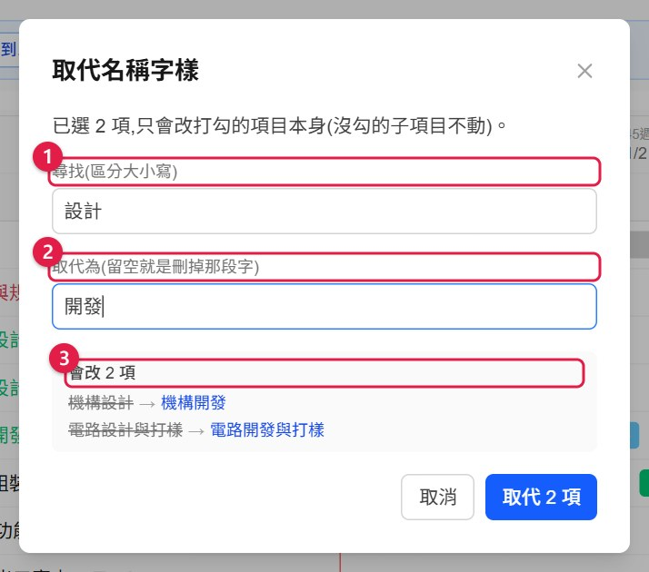

1. **尋找**:要換掉的字樣。
2. **取代為**:換成什麼;**留空**就是把那段字刪掉。
3. 下方即時列出每個項目改完的名稱(舊名稱劃線 → 新名稱),以及「會改 N 項」、有幾項沒有這段字樣。確認後按「取代 N 項」。

規則:

- **只改打勾的項目本身**,不會連帶改沒勾的子項目(這點和複製、移動、刪除不同)。想改整串,請把子項目也一起勾起來。
- 照字面比對,**區分大小寫**。「.」「(」「$」這些符號都當一般文字,不是規則運算式。
- 名稱裡出現幾次就換幾次,例如把「PoC」換成「POC」,「PoC-1 spec / PoC-1 review」兩處都會換。
- 取代之後名稱會變成空白的項目會**略過**(不會被改成「未命名項目」),預覽裡會註明。
- 需要結構權限(管理者、主管,或該分組的負責角色)。勾選的項目涉及的分組只要有一個沒權限,整批都不會改。
- 每個被改的項目,項目卡片的「活動紀錄」分頁會留下一筆「項目名稱從…改為…」。
- 這個動作**不能用「上一步」還原**(批次操作不支援復原)。取代錯了,把「尋找」與「取代為」對調再做一次,通常就能改回來。

### 7.4 刪除

按「刪除」,會先列出要刪的項目;若有**其他**工作項以它們為前置依賴,會列出受影響的項目,並讓你選:

- **改為參照被刪項目的前置**(讓後面的工作接上前一個),或
- **清空它們的前置**(它們會停在目前算出來的時間,系統會提醒你補上排程規則)。

刪除是移到**垃圾桶**,不是永久刪除,可以還原(見 15.6)。刪除項目限管理者,或主管**自己建立的**項目;沒有權限刪的項目會被略過並列出來。

### 7.5 複製、移動到別的看板

「複製到…」「移動到…」的第一個下拉是**看板**:選別的看板之後,分組與目標父項目改成那個看板的。清單只列你**可以新增項目**的看板(管理者、主管,或該分組的負責角色)。跨看板一律**接在目標底下現有項目的最後面**,不能選位置。

兩個看板的欄位各自獨立,所以:

- **欄位值依「欄位名稱 + 類型」對應**:目標看板有同名、同類型的欄位(例如 Start、Days、Status、負責人)就帶過去;狀態、優先度這類選項依**選項名稱**對應。目標看板對不上的欄位值,或找不到同名選項的狀態,會**略過**,完成後的訊息會告訴你略過了哪些。
- **前置依賴只保留這次一起處理的項目之間的**,指到範圍外的會清掉(跨看板的依賴不能單獨存在)。
- **Lvl、Type=Summary** 依目標位置重算。

**跨看板複製**:同 7.1,不含指派人員、留言、附件、連結、待辦、工時;原看板的項目不動。

**跨看板移動**是**真的搬過去**:項目連同子項目改成屬於目標看板(項目本身不變),**留言、附件、連結、待辦、工時、更新記錄、指派都跟著走**。綁在原看板的東西搬不走,處理方式如下:

- 有**已下單、支出、預算紀錄**,或**對應了預算階段**的項目:**直接擋下**,訊息會點名是哪些項目;請先處理,或改用「複製到…」。
- **樣機使用紀錄**(指到原看板的樣機):清掉。
- 原看板**別的項目**的前置依賴指到被搬走的項目:清掉,它們的日期照剩下的規則重算。
- 搬的人與原看板的分組都需要**結構權限**(同 7.2)。

跨看板的複製與移動**不能用「上一步」還原**。移動錯了,可以再從目標看板搬回來(欄位值會再依名稱對應一次)。

---

## 8. 看板(Kanban)視圖

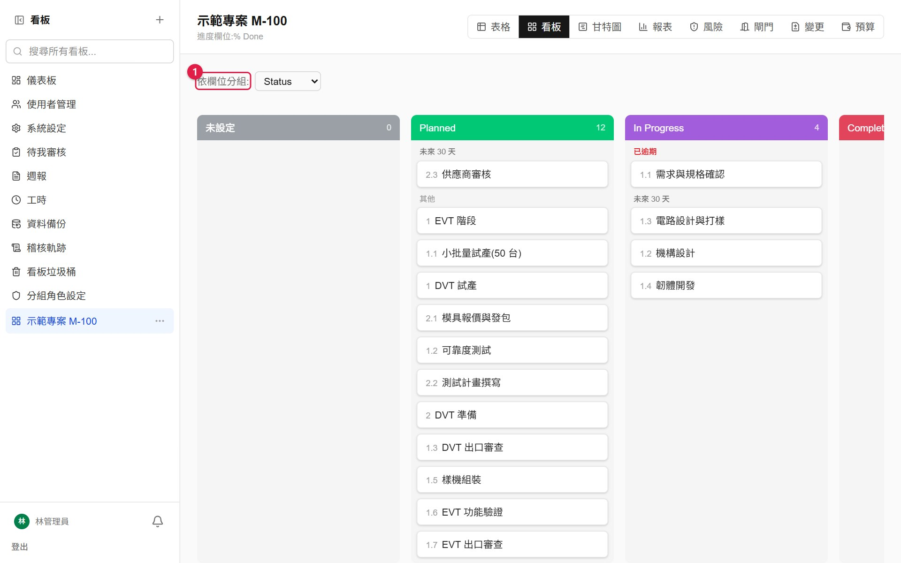

- 上方「**依欄位分組**」選一個狀態欄位(例如 Status),每個選項成為一欄;也可以選「**到期時間**」,分成「已逾期 / 本週完成 / 未來 7 天 / 未來 30 天」。
- **拖曳卡片**到另一欄,就是把那個項目的狀態改成該欄(會被記進「上一步」)。
- 點卡片開啟項目卡片。
- 主管可以用「我的團隊 / 全部」切換只看團隊的項目或全部;「我的團隊」是**主管自己加上所有部屬**(沒有部屬的主管,看到的就是自己負責的項目)。

---

## 9. 甘特圖

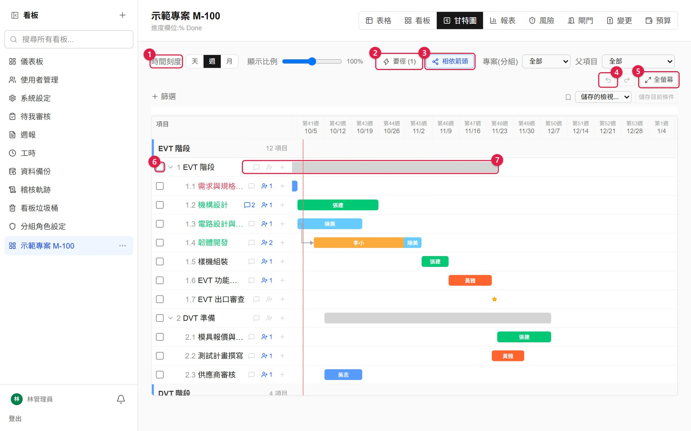

### 9.1 工具列

| 編號 | 功能 |
|---|---|
| ① 時間刻度 | 天 / 週 / 月 |
| ② 要徑 | 標出「延一天整個專案就延一天」的項目(總浮時為 0) |
| ③ 相依箭頭 | 在長條之間畫出前置依賴的箭頭;點箭頭可以修改或刪除那條連結(見 9.5.1) |
| ③b 建立連結 | 管理者、主管才有:在甘特圖上建立前置連結(見 9.5.1) |
| ④ 上一步 / 下一步 | 見第 6 章 |
| ⑤ 全螢幕 | 擴大成整個螢幕,按「退出全螢幕」回來 |
| ⑥ 勾選框 | 勾選後批次複製 / 移動 / 取代名稱 / 刪除(第 7 章) |
| ⑦ 長條 | 見下 |

另有「顯示比例」滑桿、「專案(分組)」與「父項目」篩選、「+ 篩選」與「儲存的檢視」(與表格相同)。

- **搜尋項目名稱**:「父項目」旁邊的搜尋欄,輸入名稱的一部分(不分大小寫)就只留下名稱符合的項目,**連同它們的上層**一起顯示,這樣在階層裡才看得出位置;旁邊寫有幾個項目符合。**搜尋中不管收合**——符合的項目就算藏在收合著的上層底下也找得到,清掉搜尋就恢復原本收合的樣子。搜尋可以跟分組、父項目、「+ 篩選」一起用,也會存進「儲存的檢視」(跟表格的搜尋是同一個檢視設定)。

### 9.2 怎麼看長條

- **顏色**依指派的人區分,多人共同做的會分成幾段;長條上顯示人員姓名的前兩個字。
- **灰色長條**:沒有指派人員,或是 Summary 父項(範圍由子項統計)。
- **星形**:里程碑。
- **紅色豎線**:今天。時間刻度為「日曆天」時,週末與國定假日有淺色底;為「工作天」時,時間軸直接略過非工作日。
- **要徑**打開後,在要徑上的長條會有紅色外框與閃電。
- 建立**基準線**後,每根長條下方會多一條細線,是當初的計畫日期。
- 項目名稱的顏色代表狀態(完成 / 逾期 / 進行中),顏色可由管理者調整。
- **滑鼠停在長條上**,會顯示:指派人員與投入 %、**開始日期、結束日期、工作天數**、總浮時與最晚完成日。

### 9.3 拖曳調整時程

需要時程權限(建立者、管理者、Team Leader / PMD)。

- **拖移整根長條**:整體搬到新的開始日,天數不變。
- **拉長或縮短**:拖長條左右兩端,改開始日或結束日(天數會跟著重算)。
- 放開後會先跳出**確認視窗**,列出這個項目的新舊日期,以及會被連動的後續項目;按「確定」才會套用。

拖不動的常見原因(滑鼠停在長條邊緣會說明):

- 開始或結束日由**前置依賴**決定;
- 它是**父項**,時程由子項目統計;
- 它是**里程碑**,天數固定;
- 你沒有調整這個項目時程的權限。

### 9.4 父項目的長條

有子項目的父項,長條會**自動涵蓋所有子項目的範圍**(最早的開始到最晚的結束),子項目調整後它會跟著變。例外:父項目自己設有 **Pred(前置依賴)**時,它保留依前置排出來的自己的日期,子項目要落在它的區間內。

### 9.5 前置依賴(Pred / Link / Lag)

在表格的 Pred 欄、項目卡片或下面的人員分配視窗設定。

- **Pred**:選擇這個項目要等誰;可以選**多個**前置,時間以排得最晚的那一條為準。
- **關聯類型 Link**:
  - **FS**(完成 → 開始):前置完成後,這個才開始。最常見。
  - **SS**(開始 → 開始):前置開始後,這個才開始。
  - **FF**(完成 → 完成):前置完成時,這個一起完成。
  - **SF**(開始 → 完成):前置開始,這個才完成。
- **Lag**:兩者之間再空幾天;負數代表可以提前。
- 每一個前置還可以**各自**設關聯類型與 Lag(在 Pred 選單裡每一條前置旁邊)。**新選的前置,這個項目的 Link 欄已經填了關係(FS / SS / FF / SF)就沿用它**(下拉顯示「預設(沿用 Link 欄)」),不會被蓋過;**Link 欄空白才預設是 FS**,而且直接寫在這條依賴上,所以選完就會排出日期,不用另外去填 Link 欄。要換成別種就改旁邊的下拉;選「**預設(沿用 Link 欄)**」則改回看這個項目的 Link 欄位;Lag 留空表示沿用 Lag 欄位。
- **Pred 選單裡看得到「目前這個項目」**:選前置的清單照 WBS 樹排好,正在編輯的這個項目自己(不能當自己的前置)仍然留在原本的位置,用**紅框**框起來、右邊寫 **current task**、不能點,讓你一眼看出「我在清單的哪裡」;打開選單時也會直接捲到這裡。
- Pred 欄位旁有**燈號**:綠 = 前置已完成,可開始;橘 = 等待前置;紅 = 前置已逾期,被延後(預設顏色,管理者可以調整)。
- 改了前置、天數或日期,後續依賴它的項目會**自動重新排程**。
- **里程碑也一樣會照前置排出日期**:里程碑(Type 選 Milestone)的 Days 欄固定是 0、不能填,新建的里程碑那一格是空白——系統把它當 0 天算,設好 Pred 與 Link 之後 Start / Finish 會照前置排出來(FF:完成日 = 前置完成日 + Lag,開始日同一天),Days 也會補成 0,甘特圖上就畫得出星形。把 Type 改成 Milestone 也會馬上重算。
- 如果某個里程碑**以前**就設好了 Pred 與 Link、日期卻還是空白,到「系統設定 → 甘特圖欄位設定」按該看板的「重算全部」,或隨便改一下它的 Lag(填 0 也行),就會補上。

### 9.5.1 在甘特圖上建立前置連結

不用開項目卡片,直接在甘特圖上把兩個任務連起來。**管理者與主管**可以用(權限跟編輯 Pred 欄位一樣)。

**做法一:拖曳圓點(最直覺)**

1. 滑鼠移到長條上,**兩端會出現圓點**。
2. 從**前置任務**的圓點拖出一條線,拖到**後續任務**的長條上放開。
3. 關係由「從哪一端拉到哪一端」決定:

| 從前置的 | 放在後續的 | 關係 |
|---|---|---|
| 右端(完成) | 左半(開始) | **FS** 完成到開始 |
| 左端(開始) | 左半(開始) | **SS** 開始到開始 |
| 右端(完成) | 右半(完成) | **FF** 完成到完成 |
| 左端(開始) | 右半(完成) | **SF** 開始到完成 |

拖的時候線的終點會標出落在哪一端:**藍色圈**代表可以連,**紅色圈**代表不行(旁邊寫原因)。

**做法二:建立連結模式(點兩下)**:按工具列的「**建立連結**」,先點**前置任務**、再點**後續任務**,建立的是 FS。按 Esc 取消已選的前置,再按一次 Esc 結束這個模式。長條很小、要捲動畫面時比拖曳方便。

**放開之後先預覽,不會直接寫入。** 視窗會列出後續任務的日期會從哪天改成哪天、連帶有哪些項目會跟著移動(跟拖日期條時的確認視窗同一套),讓你選:

- **緊接前置,重算日期**(預設):後續任務依排程規則接在前置後面。
- **保持目前日期(延遲 N 天)**:後續任務的日期不動,系統自動算出剛好讓它不動的延遲天數填進去。

**不能建立的連結**(會直接告訴你原因):連到自己、這條已經存在、父項目與它底下的子項目互連(父項目的時程是子項目統計出來的)、會形成循環(前置自己已經在等這個任務)。

**修改或刪除**:開著「相依箭頭」時,**點那條箭頭**會跳出小卡,可以改關係(FS / SS / FF / SF)、延遲天數(負數 = 提前),或刪除連結。刪除一律先確認。

建立、修改、刪除都可以用「**上一步**」還原(第 6 章)。目前只能連同一個看板上的項目;跨看板的前置請在項目卡片的 Pred 選單勾「跨看板」。

### 9.6 點長條:人員分配視窗

點長條(不拖動),會開啟這個視窗:

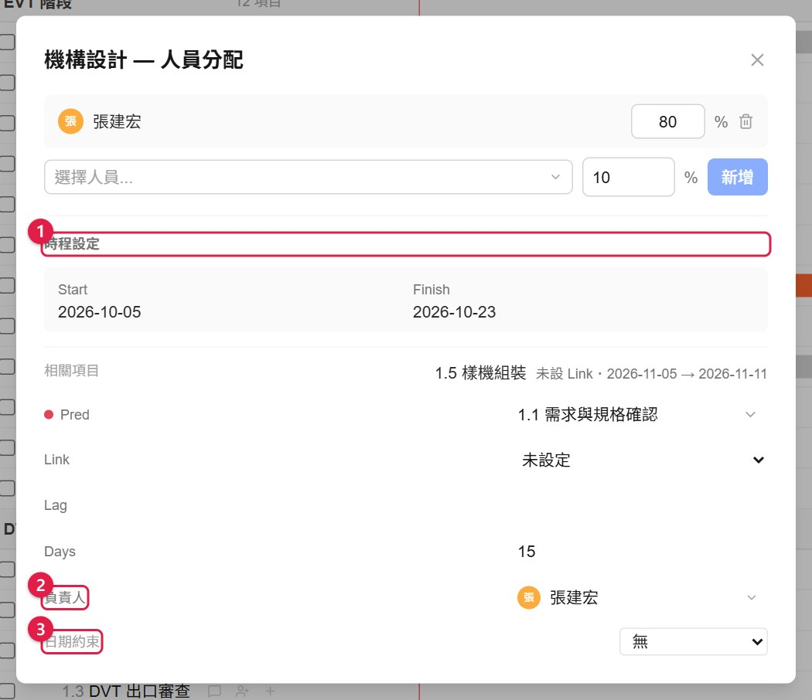

| 區塊 | 說明 |
|---|---|
| 人員分配 | 選人、填投入百分比後按「新增」,即指派給這個項目;百分比會換算成工時與成本。選人的選單有搜尋框(見下);百分比 1–100%、最小單位 1%,游標在輸入框裡時可以用滑鼠滾輪加減(往上滾增加),已指派的人改了數字,停手半秒後自動儲存 |
| ① 時程設定 | Start / Finish 顯示目前結果;下方可以設 Pred、Link、Lag、天數(或 start(set)) |
| ② 負責人 | 設定「負責人」欄位的人 |
| ③ 日期約束 | 不得早於 / 不得晚於 / 必須完成於,再選日期 |

**選人時搜尋**:按「選擇人員…」後,選單最上面有搜尋框,輸入姓名(或其中幾個字)就會過濾名單,按 **Enter** 直接選第一個符合的人;都不符合會顯示「找不到符合的人員」。「負責人」欄位、新增子任務時的人員選單也一樣(「負責人」選單多一個「未指派」,輸入關鍵字時會先收起來)。

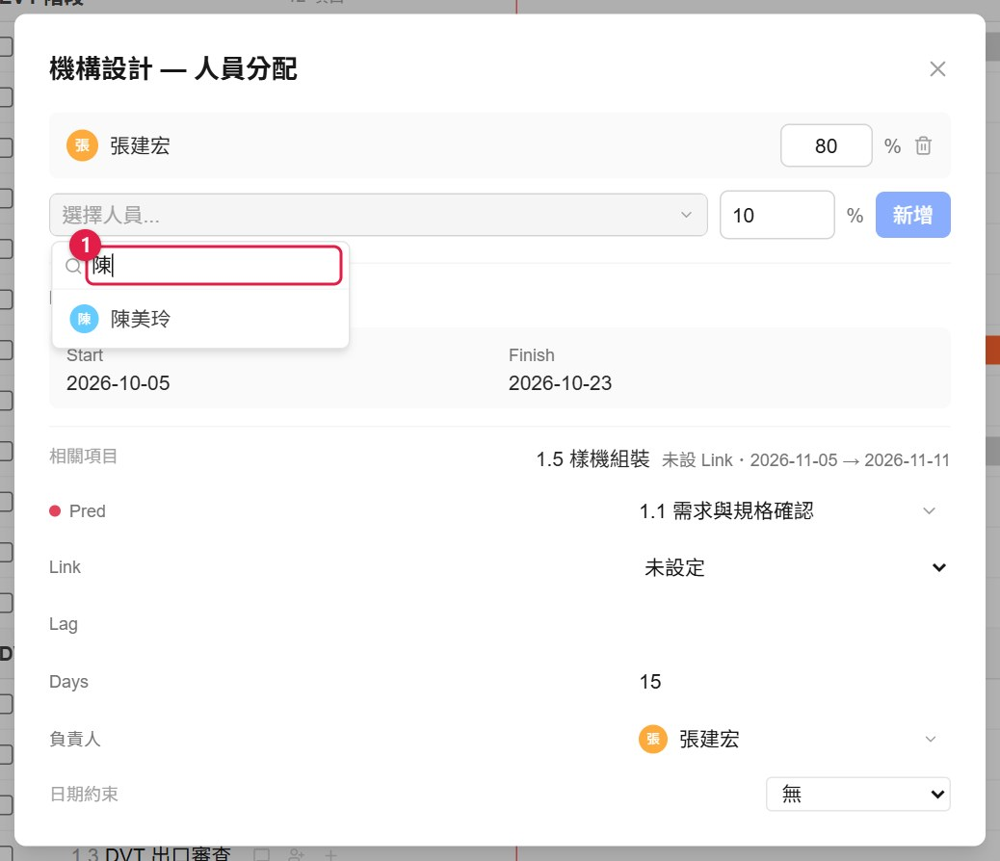

改了會影響日期的欄位時,視窗會先預覽「Start / Finish → 新日期」,並問「此變更將調整時程,是否套用?」,按「確認套用」才會生效。

### 9.7 自動排程看板

有些看板啟用了「自動排程」:Start / Days / Finish 變成**唯讀**,改填 **start(set)**(手動開始日)與 **duration**(手動天數),再由前置依賴自動算出結果。管理者在「系統設定 → 甘特圖欄位設定」對應這些欄位,並可以按「重算全部」重新計算整個看板。

- **欄位要先對應才算數**:只是欄位名字叫 start(set)、duration 並不會啟用;要在「甘特圖欄位設定」的「手動開始日期欄位」「手動天數欄位」選好這兩欄(兩個都選才算啟用)。沒對應的看板,Days 是自己填的,duration 欄只是一般的數字欄,不會影響日期。
- **Days 是算出來的**:自動排程的看板上 Days 一律唯讀,顯示由 duration 算出的天數(沒填 duration 時沿用原本的 Days);Start / Finish 同樣唯讀。
- **跟日期約束一起用**:項目設了「必須完成於 11/03」又填了 duration 23,不用 start(set) 也會算出 10/12 ~ 11/03,甘特圖畫出 23 天的條;這時 start(set) 不再決定日期(完成日以約束為準)。

---

## 10. 報表

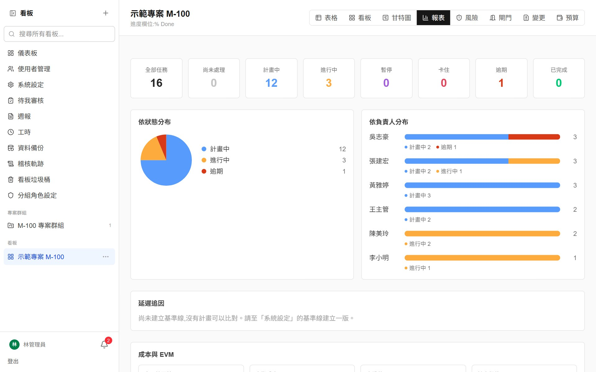

- 上方數字卡:全部任務、尚未處理、計畫中、進行中、暫停、卡住、逾期、已完成。分類依「報表設定」把各狀態歸到哪一類。
- **依狀態分布**、**依負責人分布**:圖表。主管可用「我的團隊 / 全部」切換範圍。
- **延遲追因**:找出**自己**延誤的工作項(扣掉前置推給它的部分之後仍然晚了),與影響多少下游。需要先建立基準線。
- **成本與 EVM**:完工總預算 BAC、實際成本 AC、實獲值 EV、計畫價值 PV、成本效率 CPI、進度效率 SPI、成本差異 CV、完工預估 EAC。需要有直接費用預算與成員時薪。
- **進度曲線**、**逾期清單**。

> 報表要統計哪個狀態欄位、每個狀態算哪一類,由管理者在「系統設定 → 報表設定」指定。

---

## 11. 風險與問題

NUDD 會議上談到的風險與問題,記在這裡才追得下去。

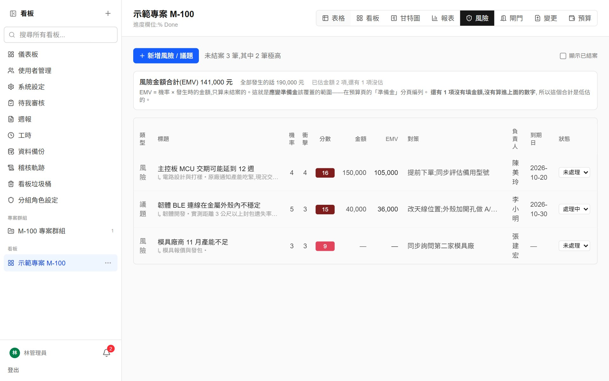

- 清單依「**機率 × 衝擊**」分數由高到低排;已結案的沉到最後。
- **分數**:機率與衝擊各 1–5,相乘 1–25:低(< 4)、中(4–7)、高(8–14)、極高(≥ 15)。
- **EMV 風險金額**:機率 × 發生時的金額,只算未結案的(包含待審核),就是**應變準備金**該覆蓋的範圍。沒填金額的項目不會算進去,畫面上會提醒你合計偏低。
- **狀態欄**:負責人與編輯者可以直接在「未處理 / 處理中」之間切換;**待審核**會標出已同意的審核人數(例如 1/2),輪到你審核的另外標紅色的「等你審核」;**已結案**不能直接選,要走 11.3 的流程。

### 11.1 誰可以做什麼

風險與問題的分工是:**指派的人**把要做什麼、做到什麼程度才算解除寫清楚;**負責人**去做、回報進度;**審核人**確認真的解除了。

| 角色 | 能做的事 |
|---|---|
| 建立者(指派的人) | 改標題、說明、機率、衝擊、金額、**對策與驗收標準**;指定**負責人**與**審核人**;寫進度更新;重新開啟已結案的;刪除 |
| 負責人 | 寫**進度更新**;切換「未處理 / 處理中」;處理完成後**申請結案**。**不能改內容** |
| 審核人 | 申請結案後**同意解除**或**退回**;也可以改內容、寫進度更新、重新開啟 |
| 管理者 | 除了「同意 / 退回」以外都可以(包含代負責人申請結案);要同意或退回,得是被指定的審核人 |
| 其他看板成員 | 只能看內容、進度更新與紀錄 |

沒有編輯權的人打開一筆,表單是唯讀的,也不會有儲存鍵。

### 11.2 新增風險 / 問題

按「+ 新增風險 / 問題」:

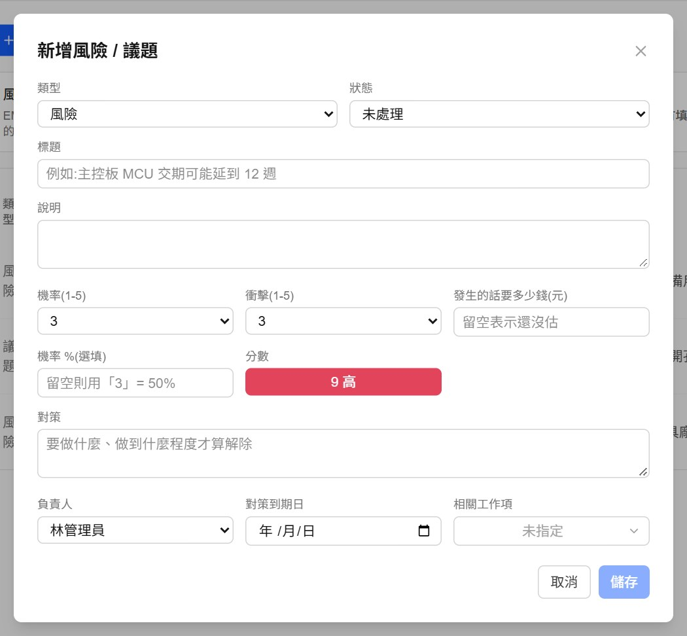

欄位:類型(風險 / 問題)、狀態(新增時只能選未處理 / 處理中)、標題、說明、機率、衝擊、發生的話要多少錢、機率 %(選填,不填則依 1–5 等級換算)、
**① 對策與驗收標準**(由指派的人寫給負責人:要做什麼、測試標準與需求、做到什麼程度才算解除)、負責人、對策到期日、相關工作項、
**② 審核人**(可以指定多位,申請結案後每一位都同意才算解除)。你自己就是這一筆的「建立者」。

### 11.3 進度更新、申請結案與審核

打開既有的一筆,上面有三個分頁:**內容與審核**、**進度更新**、**紀錄**。

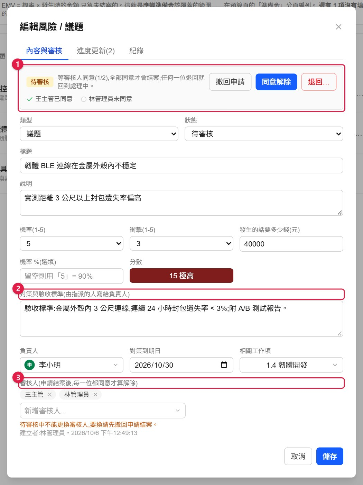

| 編號 | 說明 |
|---|---|
| ① 狀態列 | 目前狀態與下一步,按鈕依你的角色出現:申請結案、撤回申請、同意解除、退回、重新開啟;待審核時列出每位審核人同不同意 |
| ② 對策與驗收標準 | 指派的人寫的解除條件,負責人照這個做、審核人照這個驗 |
| ③ 審核人 | 申請結案後,每一位都同意才算解除 |

流程:

1. **負責人**在「進度更新」分頁寫進度(新的在上面,寫了不能改)。
2. 處理完成後,在「內容與審核」分頁按「**申請結案**」,狀態變成「待審核」。要先指定至少一位審核人並儲存。
3. 每位**審核人**按「**同意解除**」或「**退回…**」。退回一定要寫原因:原因會記進進度更新,狀態回到「處理中」,**所有人的同意票清空**,負責人補完後要重新申請。
4. **全部審核人都同意**,才會變成「已結案」。
5. 已結案的,建立者、審核人或管理者可以按「重新開啟」,回到處理中。

注意:

- 待審核中不能更換審核人;要換請先「撤回申請」(負責人、建立者、審核人都可以撤回)。
- 目前**沒有**站內通知或 email:負責人申請結案後,請告訴審核人;審核人到風險頁看有沒有「等你審核」。
- 舊的風險沒有審核人;要結案請先補上審核人。已經是已結案的維持原樣。

### 11.4 進度更新與紀錄

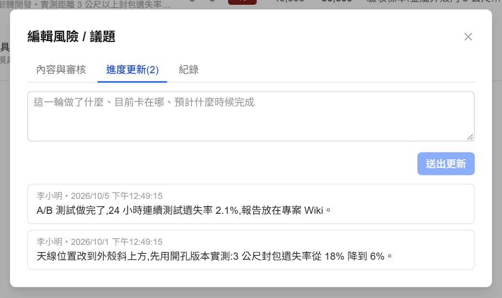

「**紀錄**」分頁會列出這一筆發生過的每件事:誰建立、改了哪個欄位(例如「負責人:李小明 → 張建宏」)、寫了進度更新、申請結案、誰同意、誰退回、重新開啟。

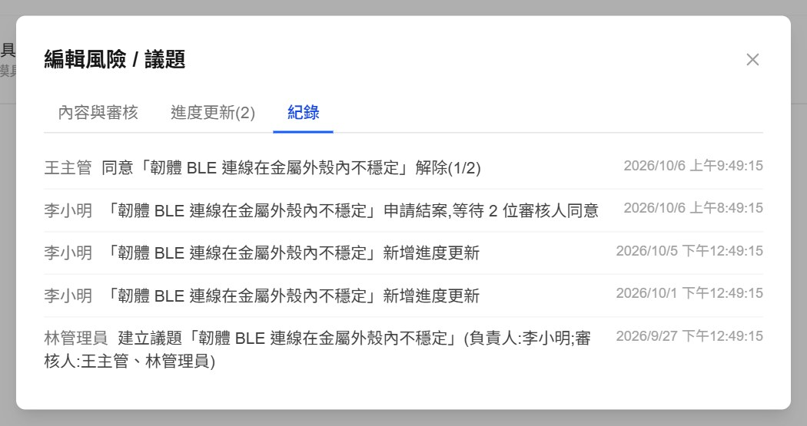

管理者也可以在「稽核軌跡」選「風險問題」分類看全部看板的紀錄,被刪掉的風險問題也會留下一筆「刪除」。

### 11.5 從 MantisBT 同步問題

專案的 bug 與問題如果記在 [MantisBT](https://mantisbt.org/),可以讓它**單向同步**進看板的風險與問題(只讀 Mantis,不會改 Mantis):

- **誰設定、怎麼設定**【管理者】:系統設定的「**MantisBT 同步**」卡片,「新增連線」。選看板、貼 Mantis 網址、貼 API token(在 Mantis 的「我的帳號 → API 權杖」建立,那個帳號要能檢視該專案),按「讀取專案」挑 Mantis 專案,「儲存並同步」。**一個看板對一個 Mantis 專案**,一個 Mantis 專案也只能對應一個看板。需要 Mantis 2.20 以上。token 加密後存放,不會再顯示出來。

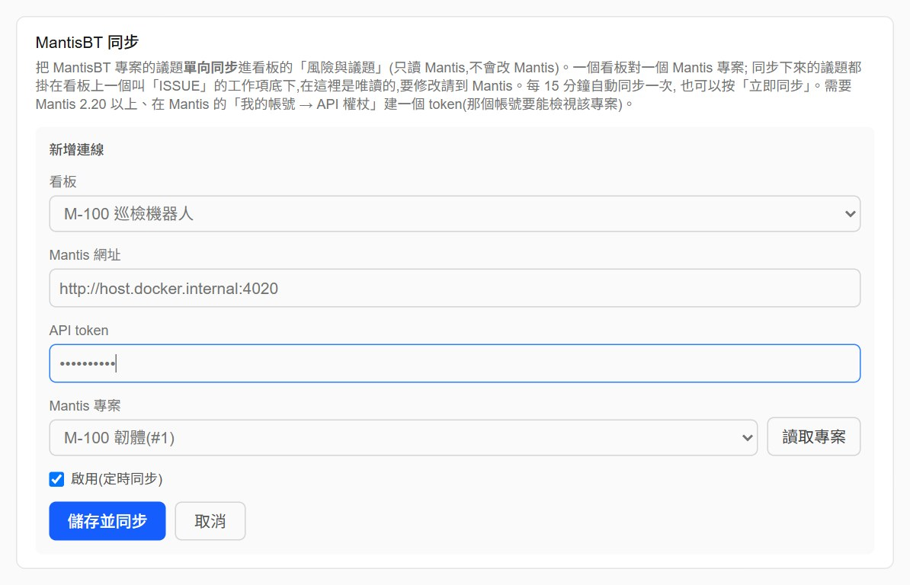

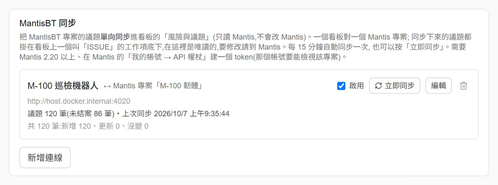

- **同步哪些**:這個 Mantis 專案的所有問題,變成看板「風險與問題」裡的「問題」,**都掛在看板上自動建立的「ISSUE」工作項底下**(放在第一個分組,可以自己搬位置)。每 15 分鐘自動同步一次,也可以按「立即同步」;失敗的原因(token 被拒、網址被轉址、找不到 REST API、逾時)會寫在卡片上。
- **欄位怎麼對應**:標題 = Mantis 摘要;說明 = Mantis 說明 + 最近 5 則備註;**狀態**依 Mantis 的狀態編號——沒人處理(new、feedback、acknowledged、confirmed)= 未處理,assigned = 處理中,resolved 與 closed = 已結案(自訂狀態也照編號歸類);**衝擊**依嚴重度(trivial 以下 1、tweak 2、minor 3、major 4、crash 與 block 5),機率固定最高(問題是已經發生的事);**負責人**用處理人的 Email 對應本系統的使用者(對不到就沒有負責人);到期日用 Mantis 的到期日。
- **在風險與問題頁**:Mantis 來源的有「Mantis #123」標記(點下去開 Mantis 該問題),上方多一個「**來源**」篩選(全部 / 手動建立 / Mantis 同步)。這些問題是**唯讀**的——內容、狀態、結案流程和刪除都鎖住,因為下一次同步會用 Mantis 上的內容蓋回來,要修改請到 Mantis;「進度更新」是這邊自己的時間軸,照常可以寫。

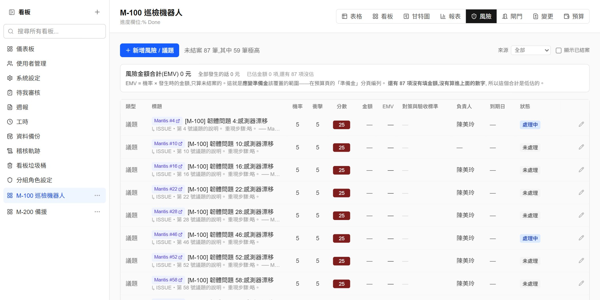

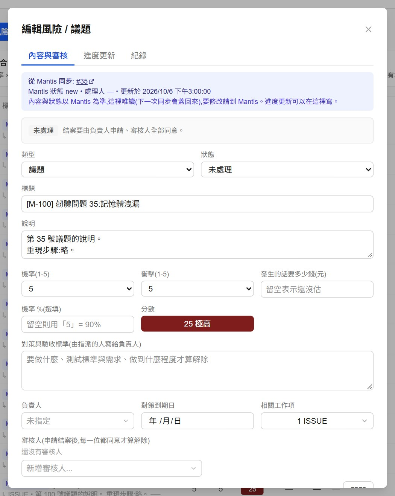

- **「問題」分頁**:連了 Mantis 的看板,在「風險」旁邊多一個「問題」分頁,專門看同步下來的 Mantis 問題(看得到看板的人都看得到,唯讀)。上方是連線的 Mantis 專案、上次同步時間(管理者有「立即同步」)與狀態統計(全部 / 未處理 / 處理中 / 已結案,點一下就篩);可以搜尋標題、編號、處理人、分類,也能依處理人篩選。同步成功卻一筆問題都沒取到時,這一頁會直接說明是用哪個 Mantis 帳號在讀、那個帳號看不看得到這個專案(最常見的原因是 token 的帳號沒有專案的檢視權限)。有兩種看法:
  - **清單**:每筆問題的 Mantis 資訊——編號(點下去開 Mantis)、摘要、狀態、嚴重度、優先權、處理人、回報人、分類、到期日、更新時間;未結案的在前、嚴重的在前;點一列展開看說明與建立 / 更新時間。
  - **依處理人**:每位處理人一張卡,列出他手上的問題與各狀態筆數;處理人用 Email 對應到本系統的同仁(對不到的標「Mantis」,沒有處理人的放最後)。

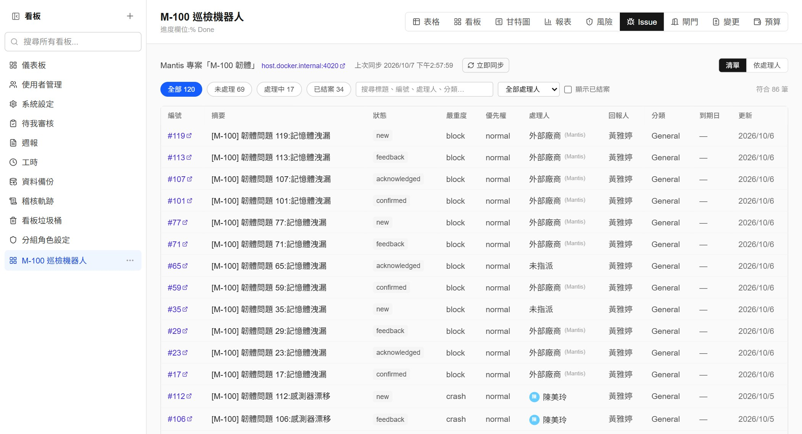

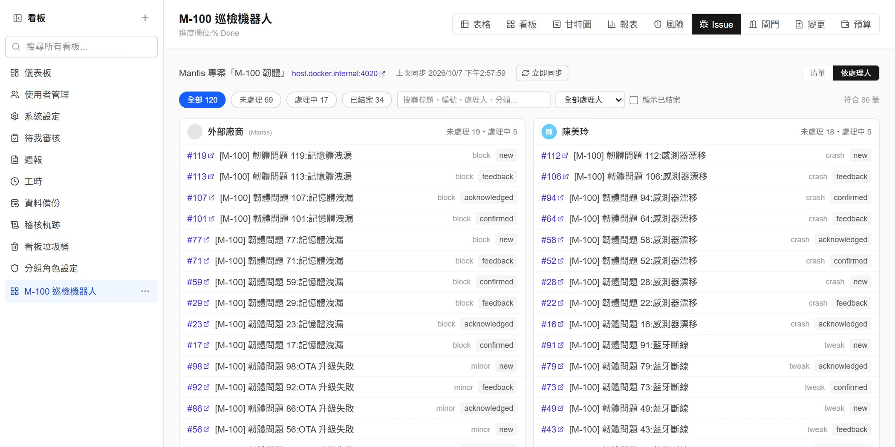

- **項目卡片的「連結」**:在工作項的連結分頁貼一個 Mantis 問題網址(`…/view.php?id=123`),如果它是這個看板所連的 Mantis 網站,連結旁會顯示同步到的 Mantis 狀態與處理人(沒同步到的標「尚未同步」)。

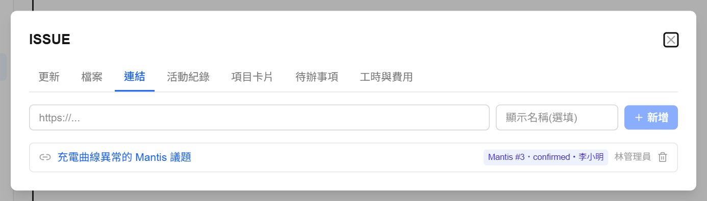

- **刪除連線**:已經同步下來的問題保留,但變成一般問題——不再同步,也可以自己修改。停用連線則只是暫停同步,問題維持唯讀。

---

## 12. 階段閘門

每個階段(POC / EVT / PVT)的出口審查:條件、簽核人,以及是誰放行的。

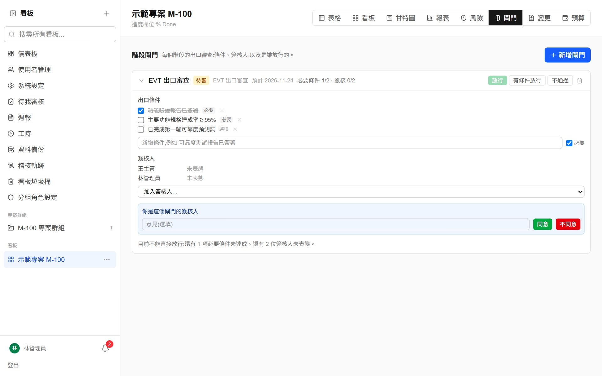

1. **建立閘門**【主管以上】:按「新增閘門」,填名稱(例如 EVT 出口審查)、可綁定一個階段、預計審查日。
2. **加入條件**:每一條可標為「必要」或非必要,達成後勾選。
3. **加入簽核人**:沒有簽核人的閘門只是一張清單,不能放行。
4. **送審**:狀態變成「待審」。
5. 簽核人各自選「核准」或「不通過」,可附意見。
6. 主管以上**放行**。必要條件沒全部達成、或簽核沒過,就不能放行,只能選「**有條件放行**」或「**不通過**」,並且**必須寫理由**——這是之後唯一查得到當初為什麼放行的紀錄。

狀態:準備中 → 待審 → 已放行 / 不通過 / 有條件放行。若閘門還沒放行、下一階段卻已經有工作項在進行,頁面上方會出現紅色警示「有工作跑在閘門前面」。

---

## 13. 變更管理

規格或時程要改,先開一張單:為什麼改、影響多少、誰批准。

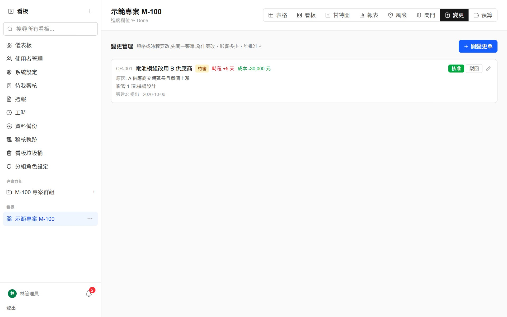

- 按「開變更單」,填:標題、原因、要改什麼、**時程影響(天)**、**成本影響(元)**、影響說明、關聯的工作項。單號自動編為 CR-1、CR-2…
- 狀態流程:**草稿 → 待審 → 已核准 / 駁回 → 已執行**;也可以**撤回**。
- **核准、駁回、標記已執行**限主管以上。駁回要寫原因;標記已執行時可連到某一版**基準線**,之後就查得到日期為什麼變。

---

## 14. 預算

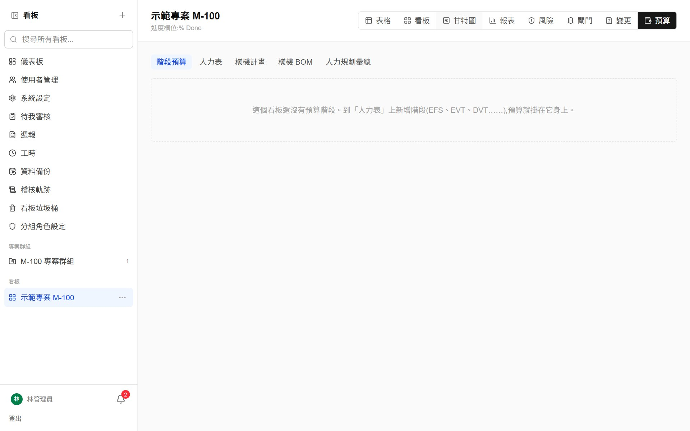

預算依「**預算階段**」編列(例如 EFS、EVT、DVT1),階段由「人力表」排出。分頁:

| 分頁 | 內容 |
|---|---|
| 階段預算 | 各類別(人力、材料〔打樣與樣品〕、模具與治具、驗證與認證、委託開發、差旅、其他)的核准預算、已花費、已下單未入帳、剩餘;**準備金**(應變、管理)的動支;**完工預估**;已下單與支出明細 |
| NRE 報價單 | 一次性工程費用(NRE)的報價與估算:照各大項逐列填細項、估算基礎、外部單位 / 人員、數量、單價、金額,自動算小計與總計;**委託開發**另有委託單位、委託項目、時間範圍與範圍(見下) |
| 人力表 | 先排出各階段的起訖日,再填每個名額每個月投入多少人月 |
| 樣機計畫 | 每個產品、用途單位在各階段要幾台 |
| 樣機 BOM | 產品在各階段用的料(廠商、型號、名稱,可往下分子集),算出單台成本;**乘上樣機計畫排的台數**就是這個產品的材料預算(見下方「材料預算怎麼算」) |
| 人力規劃彙總 | 由人力表彙總而來,人月乘上月薪就是人力預算金額(唯讀);月薪怎麼選見下方「人力預算怎麼算」 |

**樣機計畫怎麼填**:每一格是台數(某個產品、某個用途單位、某個階段要幾台),**直接在表格上打數字**,不會跳出對話框。
- 點一格(或用 Tab 走到)就能打:**Enter 或點到別的地方就存檔**,Esc 放棄這次輸入;清空存成 0(0 是存起來的值,那一列不會消失)。只收數字,最多 4 位。
- **Tab / Shift+Tab** 一格接一格往右、往左走,整列填完不必碰滑鼠。
- 「**+ 新增用途**」(或某個產品「小計」那一列右邊的「+」)新增一列之後,游標會直接在新那一列的第一格,馬上就能打。
- **備註**(例如 mock up):格子左邊的小圖示(滑鼠移到那一格才出現);已經有備註的格子,左邊直接顯示備註文字,點一下可以修改。
- 台數一存,那個階段的材料預算就跟著重算(見下方「材料預算怎麼算」)。編輯的權限跟階段預算一樣:管理者、看板擁有者、或這個看板**任一分組**的 Team Leader(樣機 BOM 也是),其他人只能看。

**每一台樣機與「使用樣機」**:樣機計畫的一格寫「M3 / SW / EVT1 要 7 台」,系統就自動排出 **7 台樣機**(第 1 ~ 7 台),頁面下方的「**樣機清單**」(點開來看)列出每一台,以及**哪些工作項正在使用它**。測試用的工作項在表格的「**使用樣機**」欄選要用哪幾台(見第 3 章的表格欄位)。
- **台數增加**:自動補上新的號碼(7 → 9 就多出第 8、9 台)。
- **台數減少**:從**最大的號碼**開始拿掉(9 → 7 拿掉第 8、9 台),小號碼的保留。**不會擋住你的修改**;被拿掉的樣機如果有工作項在用,那些工作項的「使用樣機」會**一併解除**,存檔之後跳出說明告訴你拿掉了哪幾台、哪些工作項被解除(也會在那些工作項的活動紀錄留一筆),需要的話請重新替它們選別的樣機。
- 刪除樣機計畫的一列、刪除產品(刪除前的確認會說明有幾台樣機、幾個工作項在使用)、從 Excel 匯入把台數改小,都是同樣的處理;產品改名時,樣機跟著改名、工作項的選擇不受影響。
- 以前已經排好的樣機計畫,升級時會自動補出對應的每一台樣機。

**人力預算怎麼算**(階段預算「各類別」裡的人力那一列,金額由人力表計算):每個名額的人月 × 一個月多少錢。
- 人力表裡**指到某個人、而且管理者在使用者管理替他設了「月薪」**的名額,用**他的月薪**算。
- 還沒指人(TBH),或指到的人沒設月薪的名額,用**單位標準月薪**(系統設定)。
- 所以在使用者管理改某個人的月薪,凡是人力表裡指到他的看板,人力預算會**自動連動重算**(稽核軌跡會寫連動了幾塊看板);把名額改指到別人、或刪除那位使用者,也會跟著重算。
- 只看**月薪**,不看時薪:時薪是算**實際工時成本**用的(時薪有填就優先於月薪);規劃是「幾個人月 × 一個月多少錢」,用月薪。
- 個人月薪只有管理者看得到,所以**用個人月薪算的名額,它自己那一列的金額只有管理者看得到**(其他人看到「—」);單位小計、階段與總計金額大家照常看得到。其他人匯出的人力表 Excel,金額一律用單位標準月薪列(檔案裡會註明),管理者匯出的才用個人月薪。人力表上用個人月薪算的名額,金額後面有「*」記號。

**材料預算怎麼算**(階段預算「各類別」裡的「材料(打樣與樣品)」,標「由樣機 BOM 計算」):
- 每個產品:**樣機 BOM 的單台成本 × 樣機計畫裡這個產品在這個階段排的台數**(各用途單位加起來);同一個階段有好幾個產品就各自算完再加總。**兩邊都要有**:只填 BOM、沒在樣機計畫排台數,或台數有排但那個階段沒有 BOM,材料預算都算不出來。
- 產品名稱要**一模一樣**(樣機計畫的產品欄和 BOM 的產品欄是各自輸入的文字,多一個空白、大小寫不同就是兩個產品)。
- 樣機 BOM 頁面下方會寫「× 樣機計畫排的台數 N 台 = 這個產品算進這個階段材料預算的錢」;有 BOM 卻沒排台數時,上方會出現黃色提醒。
- 這一格是存起來的數字,改 BOM 或台數時會重算寫入;**打開預算時也會對一次**,舊資料或沒走到重算的情形(例如從備份還原)會自動補上。這個階段只要有一筆 BOM,材料預算就全部由這裡驅動(算出來是 0 就是沒有編列),沒有 BOM 的階段仍是手動「設定」。

**整個專案的合計**:「階段預算」與「NRE 報價單」上方的階段下拉,**第一項是「整個專案(全部階段合計)」,打開預算時預設就是它**(要編輯某一段再選那個階段;選過的階段在這一次逗留期間會記住)。選它看的是整個看板(專案)的總數,**唯讀**:
- 階段預算:各類別的核准預算與準備金是**各階段核准金額加總**;已花費、已下單未入帳、人力實際成本、完工預估是這個看板上**所有工作項**的(包含沒有對應到任何階段的)。不能在這裡設定預算或登記訂單、支出——要編輯請選單一階段。
- NRE 報價單:每個階段、每一類的 NRE 小計;**涵蓋整個專案的委託開發**另成一列「涵蓋整個專案」;最後一列是全部加總。下面再列出委託開發的明細(範圍、委託項目、委託單位、時間範圍、金額)。

**新增一份 BOM**(某個產品在某個階段要用的料):

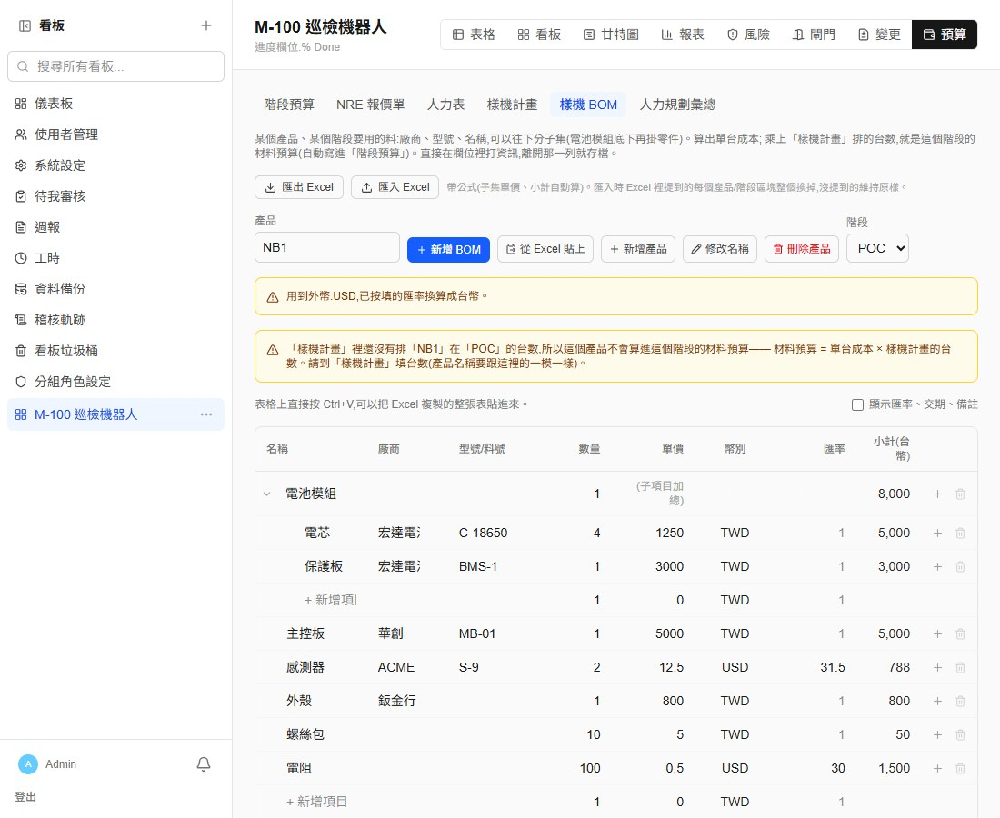

- **新增 BOM**:「樣機 BOM」分頁左上的藍色按鈕,一個視窗選好**產品**(按下面「現有產品」的按鈕,或直接打一個新的名字,會一起建立)與**階段**,再選**從哪裡開始**——空白,或**複製一份現有的 BOM**(任何產品、任何階段,整棵子集一起複製)當起點再改。建好就切到那一份。目標已經有 BOM 時不會蓋掉,會說明並留在視窗裡。
- **從 Excel 貼上**:把 Excel 或 Google 試算表的整張表複製,按「**從 Excel 貼上**」(或直接在 BOM 表格上按 **Ctrl+V**——一次貼多格的文字會自動開這個視窗,貼單一格的文字照常進輸入框)。視窗會**先預覽**讀到幾列、哪幾列有問題,按「貼上 N 列」才寫入,接在現有的列後面。
  - 欄位順序:**名稱、廠商、型號/料號、數量、單價、幣別、匯率、交期、備註**。第一列如果是表頭(欄名寫得跟上面一樣,或英文 Name / Vendor / P/N / Qty / Unit Price / Currency),就照表頭的字找欄位,順序不拘、多的欄位(例如小計)忽略。
  - **上下層**:表頭多一欄「階層」(1 = 最上層、2 = 它的子項目…),或沒有表頭時名稱前面縮排(每兩個空白一層),子項目就掛在前面最近一列比它淺一層的那一列底下。
  - 空白的欄位用預設:數量 1、單價 0、幣別 TWD。外幣沒填匯率的,用系統設定裡目前的匯率;沒有那個幣別的匯率就略過那一列。金額可以寫 NT$1,250、1,250、300 元。底下的「小計」「合計」列自動略過。
  - 有問題的列(沒有名稱、數量不是正數、單價是負的、幣別不是三個字母…)整列略過並說明是第幾列、什麼原因,其他列照貼;一次最多 300 列。
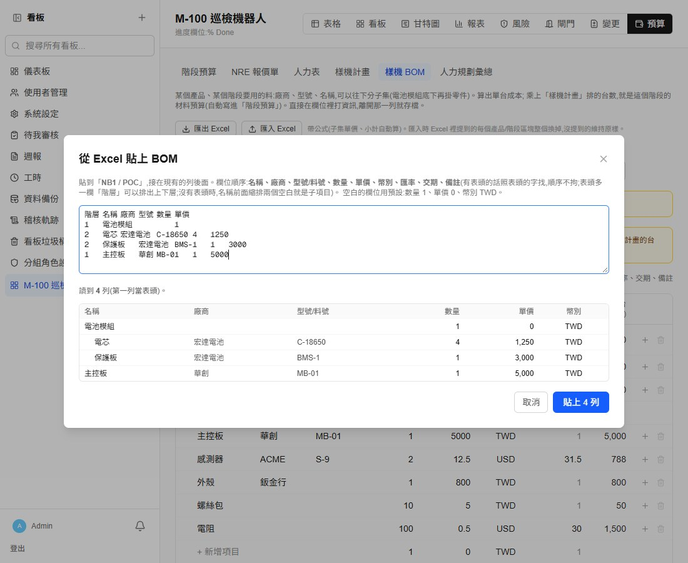

- **表格不用左右捲**:匯率、交期、備註三欄預設收起來(那一份有資料時會自動顯示);要看或要填,勾表格上方的「**顯示匯率、交期、備註**」。外幣的匯率在收起來時填在幣別格底下。
- **新增一列不用重打**:新增列(最下面的空白列)送出後,**幣別與匯率沿用剛送出的那一筆**;在任何一格按 Enter 送出,游標會回到名稱欄,可以一路打下去。廠商欄會建議這個看板填過的廠商。

**樣機 BOM 的產品**:「樣機 BOM」分頁的「產品」欄旁有「**新增產品**」「**修改名稱**」與「**刪除產品**」。
- 新增產品:輸入名稱就建好並切過去,**不必先填一列 BOM**——先建好產品,再慢慢填各階段的 BOM 與樣機計畫。名稱已經存在不能重複新增。
- 修改名稱:按「修改名稱」,輸入新名字,這個看板上用到舊名字的地方(各階段的 BOM、樣機計畫的各列、單獨建立的產品)**一起換成新名字**,BOM 與台數都不動、材料預算也不受影響,畫面自動切到新名字。新名字不能跟看板上現有的任何產品重名——不會自動合併(兩個產品併成一個會把它們各階段的 BOM 混在一起);真的要合併,請自己刪掉一個、把料填到另一個。改名會記進稽核軌跡。
- 刪除產品:會先列出它**一併會刪掉什麼**(在幾個階段的幾筆 BOM〔含子項目〕與幾列樣機計畫),確認後才刪,**無法復原**;受影響階段由 BOM 算出的材料預算會重算,其他產品不受影響。
- 「產品」欄是**下拉選單**,列出這個看板所有的產品;名字後面的括號寫它**出現在哪裡**:「手動新增」(按「新增產品」建的)、「樣機計畫」(樣機計畫裡排過的)、「BOM」(填過 BOM 的)。產品清單是這三處名字的聯集。
- 看到兩個很像的名字(例如「EVT1(BOM)」與「P100_EVT1(樣機計畫)」),通常是樣機計畫與 BOM 各自打了不同的名字——它們會被當成兩個產品,材料預算算不出來。「修改名稱」不能改成已經存在的名字(不自動合併),所以要統一的話:留一個名字,另一個產品先刪掉(連同它的 BOM 或樣機計畫台數),再到對應的分頁用留下的名字重新填。
- 要新增產品用「新增產品」或「新增 BOM」;選單裡只能選現有的,不能直接打字。

**NRE 報價單**:NRE(Non-Recurring Engineering)是新產品量產前,設計、開發、驗證、導入生產所產生的一次性費用,跟之後的產品單價分開計費。報價單按「預算階段」(POC、EVT、DVT……)各填一份,分五大項:

| 類別 | 放什麼 |
|---|---|
| 研發人力工時 | **外部單位 / 外部人員**投入的設計工時(電路、機構、韌體、軟體):填外部單位或人員、**工時(小時)**與**時薪**,金額自動相乘 |
| 委託開發 | 委託外部單位開發的項目(委外設計、委託開發軟體或模組):填**委託單位**、**委託項目**、**時間範圍**(開始日、結束日),以及**範圍**——是哪一個階段,或**涵蓋整個專案** |
| 模具與治具 | 外殼鋼模、生產組裝治具、電測夾具(通常佔 NRE 最大一塊) |
| 打樣與樣品 | PCB 打樣、3D 列印、CNC 外觀樣品、小批量試產 |
| 驗證與認證 | 環境與壽命測試、法規認證(CE、FCC、BSMI)的實驗室費用與規費 |

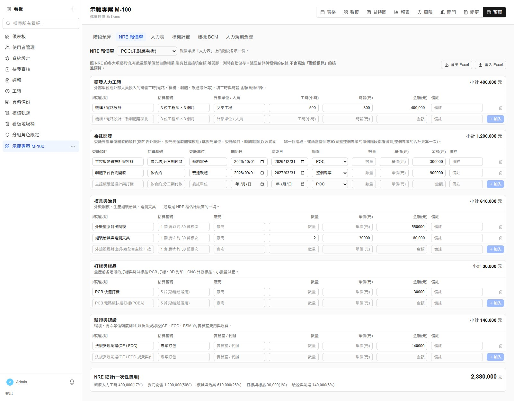

- 每一列:**細項說明**(必填)、**估算基礎**(例如「3 位工程師 × 3 個月」)、外部單位 / 廠商、**數量**、**單價**、**金額**、備註。數量與單價都填了,金額就自動相乘(四捨五入到元);沒填的話直接填金額。
- 每一類最下面那一列空白列是新增:填好按「**加入**」(或在欄位裡按 Enter)。已經存在的列直接改,**離開那一列時自動儲存**;右邊的垃圾桶刪除(會先確認)。
- 每一類有小計,最下面是 **NRE 總計**與各類佔比。
- **委託開發的範圍**:每一列的「範圍」下拉可以選「整個專案」或這個看板的任一個階段(新增時預設是現在這個階段)。選「整個專案」的列(例如橫跨 EVT 到 DVT 的外包開發)**每個階段的報價單都看得到、也算進那個畫面的總計**,但在「整個專案」的合計裡只算一次;選了別的階段,存好之後那一列就屬於那個階段的報價單,畫面會告訴你存到哪裡。時間範圍的開始日和結束日要一起填(或都不填),結束日不能早於開始日。
- 這個分類在「階段預算」的各類別叫「委託開發」(原本叫「委外」)——名稱只是改了,原本記在這一類的預算、訂單與支出都不變。
- **匯出 Excel**:右上角「匯出 Excel」把這個階段的報價單存成 .xlsx(檔名「看板-階段-NRE報價單.xlsx」)。每一類一個區塊——表頭、逐列明細、小計,最後是 NRE 總計;有數量與單價的金額、各類小計與總計都是 Excel **公式**,在 Excel 裡改數量或單價,金額會跟著算。沒有項目的類別整塊省略;橫向 A4、寬度自動縮到一頁,可以直接列印或附在報價信裡。報價單還沒有任何項目時按鈕是停用的。看得到報價單的人都能匯出。
- **匯入 Excel**(只有能編預算的人看得到這顆按鈕):把「匯出 Excel」下載的檔案在 Excel 裡改好,再匯回來——一份一份對、也可以拿來一次補很多列。
  1. 按「匯入 Excel」選檔。**先不會寫入**,會跳出視窗列出「新增幾列、更新幾列、沒有變動幾列」與每一筆改了什麼(例如「金額 550,000 → 560,000」),按「匯入」才真的寫。
  2. 怎麼對:**同一類別、同一個範圍(階段或整個專案)、同一個細項說明**就是同一列——內容不一樣就更新那一列、Excel 才有的就新增(排在該類別最後)。所以在 Excel 裡改金額、備註、數量,匯回來是更新,不會多出一列;改了細項說明的字,就會當成新的一列。
  3. **不會刪列**:報價單裡有、但 Excel 沒提到的列維持原樣(視窗會告訴你有幾列)。要刪請在畫面上按垃圾桶。
  4. 數量與單價都有就以相乘為準(跟畫面一樣);只填金額就讀金額。
  5. 有問題的列(沒有細項說明、數量不是數字、字太長…)整列略過並說明是第幾列、什麼原因,其他列照常匯入;檔案不是 Excel、或找不到任何一類的區塊時整份不匯入。
  6. 版面照匯出的樣子:每一類一個區塊,區塊表頭那一列的第一格是類別名稱(研發人力工時 / 委託開發 / 模具與治具 / 打樣與樣品 / 驗證與認證),欄位照表頭的文字找;小計與總計那幾列會被忽略。委託開發的區塊多「開始日」「結束日」「範圍」三欄:日期寫 2026-10-08 或 Excel 的日期格式都可以;範圍寫這個階段的名字或「整個專案」(空白當作這個階段),寫成別的階段的列會略過並提醒(請到那個階段匯入)。匯出的檔案包含這個階段的列,加上涵蓋整個專案的委託開發。
- 這是**估算與報價的依據,不會自己改「階段預算」的核准預算**——要把報價帶進去,到「階段預算」的「各類別」按「帶入」(見下)。
- **階段預算會顯示 NRE 報價做對照**:報價單有金額的話,「階段預算」上方多一張「**NRE 報價(估算)**」卡片,「各類別」表多一欄「**NRE 報價**」,放在核准預算旁邊,方便對照「報價多少、核准多少」。報價的每一類對到預算的費用類別:研發人力工時 → 人力、委託開發 → 委託開發、模具與治具 → 模具與治具、打樣與樣品 → 材料(打樣與樣品)、驗證與認證 → 驗證與認證。單一階段看的是那個階段的報價單;「整個專案」看全部(含涵蓋整個專案的委託開發);單一階段下方會註明「另有涵蓋整個專案的委託開發 N 元」。報價本身不影響剩餘與用掉的計算。
- **把 NRE 報價帶入核准預算**(只有單一階段、而且能編預算的人):「各類別」表的「NRE 報價」欄,報價跟核准預算不同的那一格旁邊有「**帶入**」,按了會先列出「核准預算 800,000 → 610,000」確認,才把那一類的核准預算改成報價(備註寫「由 NRE 報價單帶入」,稽核軌跡留下改之前與改之後);表格上方的「**全部帶入核准預算**」一次帶入所有不同的類別。
  - **人力、材料不帶入**:這個階段的人力預算已由人力規劃表算出來、材料預算已由樣機 BOM 算出來時,那一格是算出來的,帶入會被下一次重算蓋掉,所以略過,報價仍留在「NRE 報價」欄對照(把滑鼠停在那一格會說明原因)。還沒有人力規劃、沒有 BOM 的階段,研發人力 → 人力、打樣與樣品 → 材料也可以帶入。
  - **報價是 0 的類別不會動**核准預算;已經跟報價一樣的不用帶。涵蓋整個專案的委託開發不屬於任何階段,不會帶進單一階段。
  - 帶入是**當下的一次動作**:之後報價單再改,核准預算不會自己跟著動——兩邊不同時,「帶入」會再出現。
- 看得到這個看板的人都看得到報價單;編輯的權限跟預算一樣(管理者、看板擁有者、該看板任一分組的 Team Leader)。

重點:

- 實際花費記在對應到的那一列工作項底下;人力的「已花費」由**核准的工時**算出。
- 準備金不能直接花,要先**動支**撥進某個費用類別;動支時必須寫理由。專案總額不變,動支是搬錢不是生錢。
- 外幣支出與訂單會依輸入當下的匯率換算,事後改匯率不會動到已記的帳(匯率在系統設定)。
- 超支或預算將盡時,**儀表板**最上面會出現「預算警示」。
- **誰能編預算**:管理者、看板擁有者、或這個看板任一分組的 Team Leader;其他人唯讀。
- 整個專案群組的總預算在「專案群組」頁。

---

## 15. 看板的進階功能

側邊欄看板名稱右邊的「…」選單:

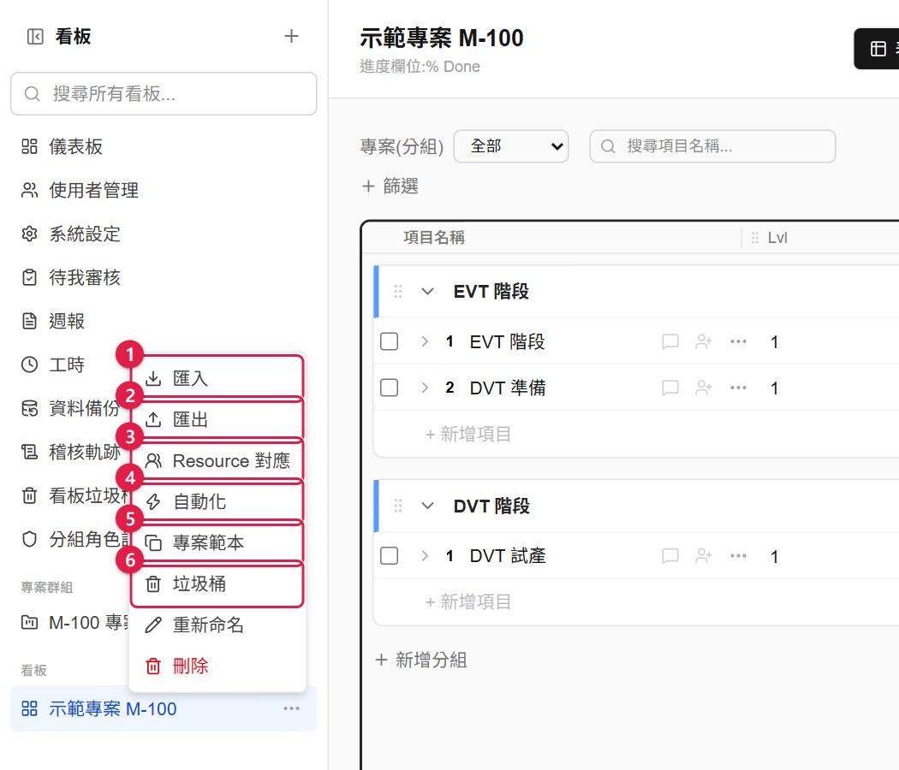

| 編號 | 功能 | 誰能用 |
|---|---|---|
| ① 匯入 | 從 Excel / CSV / Google Sheet 匯入工作項 | 管理者 |
| ② 匯出 | 匯出成 Google Sheet 用的 Gantt 檔 | 管理者 |
| ③ Resource 對應 | 把文字欄位裡的名字對應到帳號 | 管理者 |
| ④ 自動化 | 狀態變更時自動動作 | 主管以上 |
| ⑤ 專案範本 | 存成範本、套用範本 | 主管以上 |
| ⑥ 垃圾桶 | 還原被刪除的工作項 | 主管以上 |
| 重新命名 / 刪除 | 看板本身 | 管理者,或主管自己建立的看板 |

### 15.1 匯入

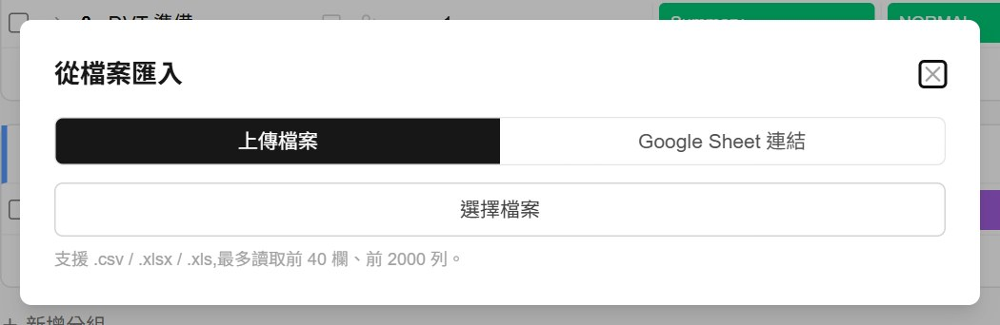

1. 選擇**上傳檔案**(.csv / .xlsx / .xls,最多讀前 40 欄、2000 列),或貼上 **Google Sheet 連結**(需設為「知道連結的使用者」皆可檢視)。
2. 選擇工作表。
3. 點選**哪一列是欄位標題列**。
4. 設定**每一欄要匯入成什麼**:忽略、項目名稱(只能剛好一欄)、階層層級(最多一欄,用來決定子項目)、對應現有欄位、或新增文字 / 狀態 / 人員 / 日期 / 數字欄位。
5. 選擇匯入到新分組或現有分組,按「開始匯入」。

注意:人員欄位只能對應到已註冊的帳號,找不到的會略過(外部人員名稱請改選「新增文字欄位」);數字欄位遇到「1.1.3」這類編號會略過,也請改用文字欄位。

### 15.2 匯出 Google Sheet(Gantt)

下載一個 .xlsx(含甘特條、要徑標記、相依連線、階層顏色、日期約束、預算、燃盡圖、延遲追因共九個分頁)與一份 Apps Script(.gs)。把 .xlsx 上傳到 Google 雲端硬碟並以「Google 試算表」開啟,再到「擴充功能 → Apps Script」貼上 .gs 內容並儲存,重新整理後就有「Gantt」選單。可選擇匯出的分組、深度與額外欄位。

### 15.3 Resource 對應

把某個文字欄位(例如 Resource 欄裡的 "SW")的每一個不同的值,對應到系統裡的使用者帳號,並可選擇同時建立人員分配。適合匯入之後整批補上負責人。

### 15.4 自動化規則

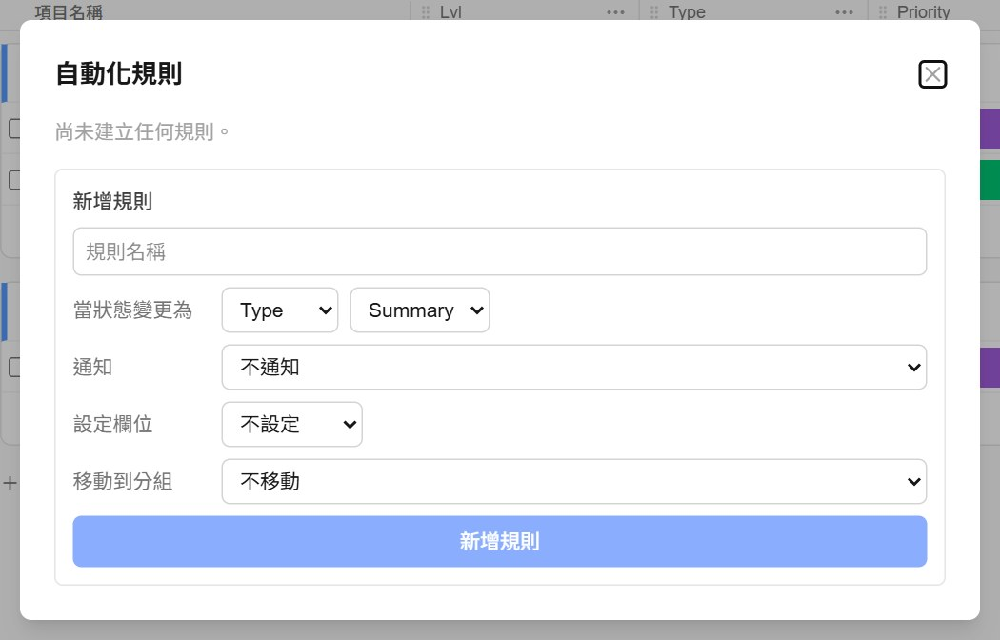

每一條規則:**當某個狀態欄位變更為某個值時**,可以同時:通知某個人、把另一個欄位設為某個值、把項目移到某個分組。規則可以隨時啟用或停用。

### 15.5 專案範本

- **從分組存成範本**:把一個排好的分組存起來,範本全站共用。
- **套用範本**:選範本、目標分組、起始日期,建立一批工作項。
- 範本只帶**結構**:名稱、階層、Type / Lvl、天數與前置關係。負責人、狀態、% 完成與日期都不會複製,日期由起始日期加上天數與前置關係算出。

### 15.6 垃圾桶(項目)與看板垃圾桶

- 被刪除的工作項會留在垃圾桶(含留言、檔案與歷史)。按「**還原**」會連同一起刪除的子項目一起還原,並把刪除時被改寫的前置依賴放回去。
- 「**永久刪除**」連留言、檔案與歷史一併消失,**無法復原**。
- **被刪除的整個看板**在側邊欄「看板垃圾桶」,主管以上可以還原,永久刪除限管理者。

---

## 16. 儀表板

登入後的首頁。右上角的「**看板篩選**」可以**複選**:點開下拉選單,勾一個或好幾個看板(勾了看板會自動取消「全部看板」,勾「全部看板」會取消其他),按「**套用**」之後,儀表板所有區塊(工作量、過度配置、進度總覽、到期清單、我的項目……)只算勾選的看板;按鈕上會顯示選了什麼(一個看板顯示名字,多個顯示「2 個看板」)。

**會記住你的選擇**:套用之後,下次打開儀表板(或換頁再回來)還是同樣的看板,不用重選;要看全部就勾回「全部看板」再套用。記的是**這個瀏覽器**上這個帳號的選擇(換電腦或換瀏覽器要重選);記住的看板如果被刪掉或你看不到了,會自動忽略、改看其他,不會變成空白。網址帶 `?board=看板代號` 時(例如舊的書籤)以網址為準;按「套用」會改用你新選的,並回到一般的儀表板網址。

**排列順序**:想先看哪一塊,按標題列右上的「**排列順序**」,列出你看得到的每一個區塊,用 ↑ ↓ 把想先看的往上移;每按一下就存一次,**順序記在你自己的帳號上**(換電腦、換瀏覽器也一樣),不影響別人。「**還原預設順序**」清掉你的排法。之後系統新增的區塊會接在最後;只有主管才有的區塊(團隊項目)沒有的人不會列出來。管理者代操作別人的帳號時只能看、不能改對方的排法。

| 區塊 | 說明 |
|---|---|
| 預算警示 | 超支、需動用準備金、接近上限的預算(沒有警示時不顯示) |
| 未結案的風險與問題 | 風險登記冊裡**還沒結案**的風險與問題(含 Mantis 同步來的:未處理、處理中、待審核),最嚴重的在最前面。每一筆有**分數**(機率 × 衝擊,依高低上色)、類型(風險 / 問題 / Mantis #編號)、標題、看板、狀態、負責人、到期日(逾期標紅)。上面的**「與我有關」**是你負責、或正在等你同意結案的(主管連部屬的一起算),**「全部」**是目前看的這幾個看板上所有未結案的;管理者預設看全部,其他人預設看「與我有關」。點一筆跳到那個看板的風險分頁 |
| 團隊工作量總覽 | 每個人在選定期間(本日 / 本週 / 本月 / 自訂)的負載百分比;可切換長條圖 / 圓餅圖。主管看自己的團隊,管理者看全部,成員看自己 |
| 過度配置 | 一天配置總和超過門檻(預設 95%,可改)的人與日期,並提示哪些有浮時的項目可以往後挪;休假日的工作也會被點出來 |
| 成員工作量明細 | 以時間軸列出每個人的任務與每週負載(顏色代表負載高低),可展開查看、點選調整 |

| 區塊 | 說明 |
|---|---|
| 看板進度總覽 | 每個看板的平均完成度與各狀態數量 |
| 待辦事項到期清單 | **逾期 / 本週完成 / 未來 7 天 / 未來 30 天**,可放大縮小、調整清單高度。**本週完成**以**實際把狀態切成完成的時間**為準(台灣時間,本週一到今天)——計畫完成日在上週、這週才切成完成的也算,提早完成的也算;沒有切換紀錄的舊資料才退回用計畫完成日在本週的判斷。看板視圖「依到期時間分組」的「本週完成」那一欄也是同一套 |
| 工作項目的待辦事項期限 | 工作項目底下**有設期限、還沒完成**的待辦事項,依期限由近到遠排:每一列寫「**工作項目 - 待辦事項**」、期限日期(例如「10/28・明天到期」,逾期的標紅)與看板名稱。範圍跟上面的到期清單一樣:一般成員看自己負責的項目(與自己新增的待辦事項),主管加上團隊,管理者看全部。**點一列**直接跳出那個項目、停在「待辦事項」分頁。 |
| 團隊項目【主管】 | 部屬被指派的項目 |
| 我的項目 | 指派給你的項目 |
| 我的團隊項目 | 你擔任窗口的資源被指派的項目 |

「工作量顏色門檻」(幾 % 算偏高、超載)由管理者在系統設定調整。

**工作量怎麼算**:

- 有「人員分配」的人,照人員分配裡設的百分比算(第 9.6 節,最小 1%)。
- 只掛在「負責人」欄位、沒有人員分配的人,仍然是這個項目的負責人(出現在他的工作項、逾期清單與週報),工作量算**預設比例**——系統預設 **2%**,管理者可以在「系統設定 → 負責人預設工作量」調整;設成 0 就完全不計入。
- 想讓負責人的工作量更精確,在項目卡片或點甘特圖長條開出的視窗裡,**負責人旁邊有選填的「工作量 %」**:填了就會把他加進這個項目的人員分配、設定那個百分比;不填就用預設比例。清空那一格不會刪除人員分配,要移除請到「人員分配」。

---

## 17. 工時

側邊欄「工時」,有兩個分頁:「我的工時」是**週行事曆**,「統計」看彙總。工時分兩種,算不算進專案成本的規則不一樣:

- **專案工作項的工時**(掛在指派給你的工作項上):要**核准**才會計入專案成本。
- **會議與其他的工時**(例行會議、部門週會、請假、出差……):預設登記就生效。但如果選了「**對應專案**」(例如為了某個專案開的例行會議、出差交通),就跟專案工時一樣要核准,核准後才計入**那個專案**的成本。

### 17.1 我的工時(週行事曆)

- 一週一個畫面,每天一欄、左邊是時間軸。① 「範本」「複製上週」見 17.3;右上角是本週合計小時;左右箭頭切換週,「回到本週」跳回今天。
- ③ 每個日期底下顯示**這一天已登記的小時**(被退回的不算);舊的、沒有排時間的紀錄會列在日期底下(「未排時間」)。
- **新增**:在空白處**點一下**(從那一格排一小時),或**拖出一段時間**;也可以按日期旁的「+」登記一筆不排時間的。
- **修改**:④ 點一筆開啟編輯或刪除;**拖曳整塊**換時間或換天;**拖下緣**改時數(以 15 分鐘為單位)。已經核准、會計入成本的工時改了日期或時數,會重新送審,拖曳前會先問你。
- 時段重疊的會並排顯示;每天欄位的最右邊留一條空白,可以在已有工時的時段旁再拖出新的一筆。
- **重複**(例行會議):新增時在登記表單選「**重複**」——「每週」(選星期幾,有「工作日」快速鍵)或「每月同一天」,再選「重複到」哪一天,下面會預覽共幾筆,按「登記 N 筆」一次建立。每一筆都照一般登記:對應專案的要核准、一天超過 24 小時的那天會被略過並說明、同一天已經有一樣的不重複建立。一次最多 120 筆、範圍不超過 400 天。用重複建立的在行事曆上有「↻」標記,開啟其中一筆可以按「**刪除這筆及之後的重複**」一次刪掉它和之後同一批的(之前的保留);要改內容就逐筆改,或刪掉重建。每週固定的會議也可以改用 17.3 的範本。

- **顏色**:藍色是專案工作項、紫色是對應專案的會議(要核准)、綠色是其他;**虛線框 = 待審**,紅色 = 已退回。一天合計不能超過 **24 小時**。

- 登記表單:上面切換「**會議與其他**」或「**專案工作項**」。工作項只列指派給你的(也可以到項目卡片的「工時與費用」登記)。
- **類別**預設有:例行會議、突發問題處理、教育訓練、行政事務、其他,以及**部門週會、公司專案週會、請假、出差、出差交通**(管理者可以在系統設定的「工時類別」增減,並決定哪些類別可以選「對應專案」——部門週會、公司專案週會、請假這類不屬於任何專案的,就不開)。「突發問題處理」可以**連結風險登記冊裡的風險或問題**(包含從 Mantis 同步來的問題,選單裡標「Mantis #編號」,可以直接打編號或標題搜尋)。這裡的「請假」只是工時類別,**不會**跟「請假」模組連動。
- 開始時間可以取消勾選「排定時間」,時數以 0.25 小時為單位。
- **備註欄會記得你以前寫過的**:點進備註欄(或開始打字),下面列出你以前登記工時時寫過的備註——這次選的工作項或類別用過的、用得多的排前面;可以打關鍵字過濾(多個關鍵字用空白隔開),用 ↑↓ 加 Enter 或直接點一下就填入,Esc 關掉建議。只會列出**你自己**的備註。

**待審與核准人**:⑤ 待審的工時開啟後,會寫出**誰可以核准**。誰核准的、用什麼身分核准的,都會記錄下來(已核准的會寫「已核准・某某」,退回的帶退回原因)。誰能核准:

1. 該專案分組的 **Team Leader / PMD**(會議對應專案時,是這個專案任一分組的 Team Leader / PMD);
2. **同部門的 DM**——只限同部門(單位)的同仁;
3. 送審者的**直屬主管**;
4. **管理者**。

以上任何一位核准就生效,但不能核准自己的工時。管理者可以在使用者管理替某個人勾選「**工時免審核**」(見 21.1):他登記的專案工時與對應專案的會議直接生效,註記為「免審核」。

### 17.1b 預估對照(人力時間預估 vs 實際工時)

行事曆下面的「**預估對照**」把這一週的**預估**跟你**實際登記的工時**並排,每天、每個專案、每個工作項都看得到差異。

- **兩種預估**:
  - **人力表預估**:人力表(預算頁)裡指到你的名額,每個月投入多少(1 = 整個月全職),× 每日工時(系統設定,預設 8 小時),攤到當月的每個**工作日**。例如人力表排你 0.7,每天就是 5.6 小時。
  - **工作項預估**:指派給你(而且有排程)的工作項,**配置比例 × 每日工時**,攤到工作項起訖之間的工作日。只算最底層(沒有子項目)的工作項,父項目的日期是子項目滾上來的,不重複算。
- **每天一欄**:表的上半部,每天一欄加「本週」,列出人力表預估、工作項預估、實際(有對應專案的工時),以及**差異**(實際 − 預估,多做是正、還沒做到是負)、**達成**(實際 ÷ 預估)與**剩餘**(100% − 達成;超過預估會寫「超出」)——對人力表與對工作項各算一次。週末與公司假日沒有預估。行事曆每天的日期底下也會寫「預估 N」。
- **各專案**:表的下半部,每個專案一列,有人力表預估、工作項預估、實際與各自的差異、達成、剩餘;按左邊的箭頭展開,看這個專案底下每個工作項的預估與實際。**點上半部某一天的表頭**,下半部就只看那一天;再點一次或點「本週」回到整週。
- **實際**只算有對應專案的工時(專案工作項,以及對應專案的會議)——部門週會、請假這類沒有對應專案的另列為「其他」,不拿去跟專案預估比,不然每開一場週會專案就「少做」兩小時。被退回的工時不算。
- 預估是**參考**,不會自動幫你登記工時;改了工時,對照表馬上跟著變。登記在沒有被指派的專案上,那個專案也會有一列,預估是 0。
- 目前不扣請假:你請假那幾天,預估還是照排。

#### 匯入預估:用工作項的預估直接建立工時

不用一筆一筆新增——行事曆上方的藍色「**匯入預估**」把指派給你的工作項**每一天的預估**直接匯成專案工時:

- 列出的是「工作項預估」那一份:**配置比例 × 每日工時**,只在工作項起訖之間的工作日;只算最底層的工作項。一天預估不到 0.25 小時的(例如 2% 的負責人預設比例)不列。範圍可以選「每週」(正在看的那一週)、「每月」或「自訂區間」,一次最多 92 天。
- 每一列有 **原預估** 與 **實際**。**實際預設就是預估**,不用改就等於照預估登記;實際花的時間不一樣,直接在「實際」欄改。底下會即時算「原預估 N 小時 → 實際 M 小時」。
- **今天以後的日子預設不勾**(還沒發生);也可以「全選」或「只選今天以前」。這一天這個工作項**已經登記過**工時的,標「已登記」、不能重複匯入(被退回的不算,可以重新匯入)。
- 匯入後是一般的專案工時:放在日期底下的「未排時間」,要核准的照樣要核准(免審核的人直接生效),一天仍不超過 24 小時。**工時會記著「原預估」**:行事曆上寫「預估 4h」,開啟那一筆會顯示「原預估 4 小時、這筆實際 3 小時(差 −1,75%)」,之後再改實際時數,原預估不變。
- 匯入的預估由系統重算後記下,畫面上改不了「原預估」,只能改實際。

### 17.2 統計

- 選期間:**本日 / 本週 / 本月**,或自己選起訖日(一次最多 366 天)。
- 勾選「**含待審核的工時**」,決定要不要把還沒核准的工時(專案工時與對應專案的會議)算進去。
- ① 「**人員**」是下拉選單:可以搜尋、**複選**,有「全選」「清除」,也能**依部門(單位)一次選一整個部門**。
- 一張表:**各類別的工時**(小時),依**專案**分組:每個專案底下是專案工作項與對應這個專案的會議等類別,不屬於任何專案的(部門週會、請假……)歸在「未歸屬專案」;每個人一列,最右邊是合計,最下面是各欄合計。

**看得到誰的工時**:自己;直屬主管看自己的部屬;管理者看全部;另外管理者可以在使用者管理替**個別主管**勾選「可以檢視全部成員的工時」。

### 17.3 範本與複製上週

例行會議(每週的部門週會、公司專案週會、每日站會……)不必每週重填:

- 按行事曆上方的「**範本**」。範本分兩種:**我的範本**(只有自己看得到,可以是會議與其他,也可以是專案工作項)和**共用範本**(管理者建立,所有人都能套用,只能是會議與其他)。
- **新增範本**:取名字,選類別(或工作項)、對應專案、開始時間、時數、備註,以及**每週哪幾天**。也可以開啟行事曆上的一筆工時,按「**存成範本**」,表單會帶入那一筆的內容。管理者新增時可以勾「共用範本」。
- **套用到這週**:範本選的每個星期各建立一筆。走一般的登記流程——對應專案的要核准、免審核的人直接生效,一天超過 24 小時的會被擋下並說明;同一天已經有一樣的(類別或工作項、專案、開始時間、時數都相同)就不重複建立。
- 刪除:自己的範本自己刪;共用範本只有管理者能刪。已經建立的工時不受影響。
- **複製上週**:把上一週的工時(被退回的除外)複製到這週,同一個星期、同一個時間,已經有一樣的就略過。複製出來的專案工時與對應專案的會議要重新核准。

### 17.4 從 Google 日曆匯入

開會的行程已經在 Google 日曆上了,不必再手動輸入一次:

- 按行事曆上方的「**Google 日曆**」。第一次要先**連結**:會跳到 Google 的同意畫面,只授權**唯讀取行程**(標題與時間),同意後自動回到原本看的那一週。系統**不保存**你的 Google 帳號、密碼或任何憑證——授權只暫存在瀏覽器約一小時,過期了再按一次連結就好。(Google 不接受用帳號密碼讀日曆,所以是這種授權方式。)

- 連結後視窗上方可以選匯入的範圍:「**每週**」(行事曆正在看的那一週,週一到週日)、「**每月**」(那一週所在的整個月)、「**自訂區間**」(自己選開始與結束日期);選好就會列出那段期間(台灣時間)的行程。一次最多 92 天(約三個月)、500 個行程,超過會提醒你縮小區間。勾選要匯入的;每筆可以選**類別**(預設「例行會議」)和**對應專案**(類別可對應專案時才有)。行程的標題會成為工時的備註,時數以 15 分鐘為單位。
- 已取消的、你已經婉拒的行程不會列出;**全天行程與跨日行程不能匯入**(工時一筆只能在同一天),列在清單下方說明。
- 匯入走一般登記流程:對應專案的要核准、免審核的人直接生效、一天不能超過 24 小時。

- **重複匯入不會重複建立**:系統記得哪些行程已經匯入(標「已匯入」,不能再勾)。如果日曆上把行程改了時間,會標出「日曆上的時間改了」,再匯入一次**只更新日期、開始時間與時數**,你自己改過的類別、對應專案與備註都保留。
- 之後在行事曆上對這些工時的修改(拖曳、改類別……)都是正常的;匯入只是幫你建立,不會反過來改 Google 日曆。
- **按「連結 Google 日曆」後,Google 的頁面出現「400 發生錯誤。伺服器無法處理格式錯誤的要求」**(網址是 accounts.google.com 或 accounts.google.com.tw 的 `/accounts/SetSID`),或「403 disallowed_useragent」:你用的是**內嵌瀏覽器**——例如 Claude 桌面版的預覽視窗、手機 App 內建的瀏覽器、LINE / Facebook 裡打開的連結。**Google 不允許在這種視窗登入**,跟系統設定、Client ID 都無關。請改用 **Chrome、Edge、Safari** 這類一般瀏覽器,開啟系統的網址再按連結。系統偵測到內嵌瀏覽器時,連結視窗會直接寫出這段說明,並有「複製這個頁面的網址」可以貼到 Chrome。
- **連結後看到「Google 拒絕讀取日曆」**:畫面會寫明是哪一種原因——「這個 Google Cloud 專案還沒有啟用 Google Calendar API」(附一個可以點的啟用網址,請管理者啟用後等一兩分鐘再按「重試」)、「這次的授權沒有包含讀取日曆行程的權限」(Google 同意畫面上「查看日曆活動」沒有打勾,按「重新連結 Google 日曆」並把權限都勾起來)、額度用完(稍後再試),其他原因會直接顯示 Google 的原話。
- **在 Google 授權完回到工時頁,出現「無法連結 Google 日曆」**:視窗會寫明是哪一步失敗、要怎麼處理,管理者也可以在伺服器的紀錄(`docker logs`,搜尋 `[google-oauth]`)看到同一個原因。常見的幾種:
  - **伺服器連不上 Google(oauth2.googleapis.com)**:公司內部的伺服器要允許對外連線到 Google,請檢查防火牆或代理。
  - **Google 認不得這組用戶端(invalid_client)**:伺服器上的 `GOOGLE_CLIENT_ID` / `GOOGLE_CLIENT_SECRET` 設錯了。
  - **「已授權的重新導向 URI」沒有登記(redirect_uri_mismatch)**:視窗會附上伺服器用的那個網址,照著一字不差登記到 Google Cloud 的 OAuth 用戶端。
  - **按了取消、或帳號不被允許**:Google Cloud 的 OAuth 同意畫面還在「測試中」時,只有加進「測試使用者」的 Google 帳號能授權。
  - **瀏覽器沒有帶回授權用的暫存資料**:多半是開系統的網址跟伺服器設定的 `APP_BASE_URL` 不是同一個(例如用 IP 或另一個網域開),請改用 `APP_BASE_URL` 那個網址。

---

## 18. 待我審核與請假

側邊欄「待我審核」(有部屬的主管、專案分組的 Team Leader / PMD / DM 與管理者才看得到)。

- **工時**:你可以核准的專案工時。**核准**之後才計入成本報表的實際成本(AC);**退回**一定要寫原因,讓對方知道要補什麼。
- **專案會議與其他工時**:選了「對應專案」的會議、出差交通等。核准之後才計入那個專案的成本。
- 誰能核准工時:該專案分組的 Team Leader / PMD、同部門的 DM(只限同部門同仁)、送審者的直屬主管、管理者,任何一位就夠;**用什麼身分核准的會記進稽核軌跡**,送審的人也看得到是誰核准的。
- **請假**:你部屬登記的休假。核准後那幾天的產能才歸零,「過度配置」才會把排在假期上的工作點出來。休假**不會**移動任何工作項的日期。
- 不能審核自己送出的紀錄。請假由直屬主管與管理者核准(設了多階簽核時,二階、三階主管也要同意,見下)。

**多階簽核(二階、三階主管也要同意)**:管理者可以在「系統設定 → 簽核層級」分別設定**請假**與**工時(主管這一條路)**要幾階主管同意。預設是「直屬主管」,跟以前完全一樣。誰是誰的幾階主管看「組織架構圖」(見 21.1b)。

- 設成「直屬主管 + 二階主管(都要同意)」之後,這筆紀錄會**同時**送給直屬主管和二階主管,不用等前一階;**每一階都同意才算核准**,任何一階退回就是退回(要寫原因)。最多可以設到五階。
- 待我審核每一列下面會多一行藍字進度,例如「需 2 階主管同意 — 已簽:直屬主管 朱課長 — 尚待:二階主管 黃部長(你是二階主管)」。你簽過的那一階,這筆就從你的待審清單消失,等其他階。
- 管理者仍然可以單獨核准或退回,不必等各階。
- 設定的階數比這個人頭上實際的主管多(例如設 3 階,但他只有兩位主管),就算到最高那一階。超過設定階數的主管(例如設 2 階時的三階主管)看不到這筆。
- 工時的設定只管「靠主管核准」那一條路;專案分組的 Team Leader / PMD、同部門的 DM 任一位同意就算核准,不受這個設定影響。
- 每一階的核准都各記一筆稽核軌跡。
- **副主管代簽**:組織架構圖裡,部門主管的副主管(或勾了「可代簽」的職能)可以代主管簽那一階——只設一階(直屬主管)時也一樣。他們也會有「待我審核」,看到「你可代簽二階主管」這樣的說明;他簽了就算那一階簽過,**主管本人不用再簽**(那一階從主管的待審清單裡消失);退回也是一位就夠。稽核軌跡會寫明是「代簽」。沒勾「可代簽」的職能(例如行政)看不到、也簽不了。

**一次處理很多筆**:每一列最左邊有勾選框(工時、專案會議與其他工時、請假都有),上面的工具列捲動時會固定在畫面最上方:

- **全選 / 全部取消**:一次勾起或取消全部待審的項目,旁邊顯示「已選 幾 / 全部 筆」。
- **依人員選取**(下拉選單):列出每個送審的人,後面是他待審的筆數。**選一個人就選他所有待審的項目**(工時、會議工時、請假都包含),選完選單會回到「依人員選取…」,可以再選下一個人疊加;已經全選的人(前面標 ✓)再選一次就取消他的。只勾了他的一部分時前面標 ◐,這時再選會補成全選。
- **核准已選 / 退回已選**:對勾選的全部一次處理。核准前會先跳出確認,寫明選了什麼(例如「已選 6 筆(工時 4、專案會議與其他工時 1、請假 1)」);退回要寫一個原因,**每一筆都會寫上同一個原因**。
- 權限、稽核紀錄跟一筆一筆按完全一樣——每一筆都會各記一筆稽核,誰核准、以什麼身分。**有幾筆做不到**(例如權限不足,或剛好被別人處理掉了)不會擋住其他的:做得到的照常處理,最後跳出說明成功幾筆、沒成功的原因。
- 每一列右邊原本的「核准」「退回」還在,只處理那一筆。一次最多處理 500 筆。

**登記請假**:目前由管理者在「使用者管理」的「**休假**」分頁替成員登記,填起訖日與事由,送出後狀態為「待主管核准」。

---

## 19. 週報

側邊欄「週報」。每週一份,涵蓋範圍跟你登入時看得到的看板一樣。

- 「產生上一週」「產生這一週(到目前為止)」可以手動補一份;右上角下拉選單翻歷史週報;「下載 Markdown」存檔;「全螢幕顯示」。
- **工作項底下附上:更新、連結、待辦事項**(按鈕旁邊的三個勾選,**預設都勾**):決定這次產生的週報,每個工作項底下附哪些資訊——「更新」是更新分頁的留言,「連結」含連結與附件,「待辦事項」是新增與勾選完成的待辦。**狀態變化(切成進行中、完成)一定會附。**排程自動產的週報三項都附。

- **每一筆也可以決定要不要進週報**:工作項視窗的「**更新**」「**連結**」「**待辦事項**」三個分頁,新增時旁邊都有「**更新至週報**」勾選(**預設勾選**),**每一則更新、每一個連結、每一個待辦事項**右邊也各有一個「**週報**」勾選,之後隨時可以改。**沒勾的那一筆不會彙整進週報**(不論上面「這次附哪些」怎麼勾);待辦事項的勾選管它的新增與完成兩筆紀錄。改別人寫的更新或加的連結要是寫的人、主管或管理者。狀態變化一定會附,沒有這個勾選。
- 內容:**工作項資訊更新**、依職能的工作項、目前逾期、未來 7 天、里程碑、要徑、風險與問題、預算、各看板進度,以及「這週 vs 上週」的差異(完成、新逾期、狀態更新、時程變化、新增 / 結案的風險)。第一份週報沒有上週可以比,所以沒有差異數字——只有「完成」例外:**這週完成**以**實際把狀態切成完成的時間**為準,不必靠上週去比,所以第一份也列得出來(沒有切換紀錄的舊資料才拿上週那一份去比)。
- **週報涵蓋的範圍**不一定是週一到週日:管理者在系統設定設定「從星期幾到星期幾」,預設**週三到週二**(見 21.3)。週數標籤(例如 W41)看範圍的最後一天落在哪個 ISO 週;「產生上一週」與排程報的是**已經結束**的那一個範圍(最後一天過完才算結束)。

- **產生前提醒同仁更新工作事項**:系統設定 → 專案週報排程裡有一欄「**週報產生前 N 小時寄提醒信**」(預設 **0 = 不提醒**,可填 0 到 168,離開欄位就存)。填了之後,每一輪週報產生**前 N 小時**,系統會寄一封信給**使用者管理裡的每一位同仁**(各單位的人都收得到,不只是週報的收件人),信裡說明:
  - 週報**什麼時候產生**(日期、星期、時間),以及這份週報**涵蓋哪一段日期**;
  - 請在那之前到系統**更新自己負責的工作事項**(狀態與進度、日期、卡住或有風險的在項目留言),週報以產生當下系統裡的資料為準。
  - 設定欄位底下會直接寫出「提醒信會在 週日 06:00 寄出,信裡會說明週報於 週一 06:00 產生」,填完就看得到寄出時間。
  - **什麼時候不寄**:排程沒有啟用,或沒有任何專案群組設定了週報收件人(週報不會寄,就不用提醒大家);同一輪只寄一次,不會重複。一封都沒寄出去(例如信箱沒設定、SMTP 暫時掛掉)時,下一次檢查會再試。

- **工作項資訊更新**:這個範圍內,工作項上有變化的**狀態切換、更新(留言)、連結(網址)、附件與待辦事項**(依上面的勾選),依工作項分組列出,網址附在後面可以直接點開。只列你看得到的工作項。**這週完成的工作項**(部門那段每個人的「這週已完成」、信裡「這一週」的「完成」清單),底下會直接接著它這個範圍內的留言、連結與附件,看一筆就知道做完了什麼、成果放在哪裡(全部列出)。

- **週報的清單一律全部列出,不截斷**——逾期、未來幾天、里程碑、要徑、各部門的清單、狀態與時程變化、工作項資訊更新、風險與問題,信件與網頁版都是,不會有「另外還有 N 項」。
- **風險與問題明細**:每個專案的「風險與問題」除了統計(風險幾項、問題幾項、尚未結案幾項),也會**逐筆列出**:類型標記(風險 / 問題,從 Mantis 同步來的標「Mantis #編號」)、**名稱、狀態**、分數、負責人、到期日,底下是看板、說明、對策、Mantis 網址,以及**這個範圍內新增的進度更新**(誰、哪天、寫了什麼,全部列出)。這個範圍內沒有新更新的,會放它**最近一次更新**,並標明日期,讓你知道是舊的。還沒結案的全部列出,已結案的只列這個範圍內才剛結案的;分數高的在前。

- **產生週報時會寄信**:按「產生上一週」「產生這一週」,每個專案各寄**一封**信給你自己,標題是「專案名稱週報 W41 (起 ~ 迄)」,內容只有那個專案的部分;一封寄失敗不影響其他封,結果訊息會說寄了幾封、哪幾封沒寄出。
- 管理者可以在系統設定排程,每週固定時間為每個專案群組**自動寄**一份給指定收件人(見 21.3)。
- **信件裡也有「依職能的工作項」**:每個職能(例如 EE 電機)底下列出每個人的逾期、這週已完成、接下來幾天的工作項,跟網頁版同一份內容。自動寄的設定裡,「**各部門工作事項**」跟「**專案時程與預算**」是兩個獨立的勾選——只勾各部門、不勾專案時程,信裡仍然會有這一段(專案名稱底下只留各部門的人);兩個都不勾才不會出現。

---

## 20. 搜尋、專案群組、資料備份

### 20.1 搜尋

側邊欄上方的搜尋框,輸入**至少兩個字**,會搜尋你看得到的所有看板:工作項名稱、留言、附件檔名、風險與問題。

### 20.2 專案群組

同一個專案拆成幾個看板(例如 POC / EVT / PVT)時,管理者可以把它們放進一個**專案群組**,前置依賴就可以**跨看板**:上一階段的驗證一延,下一階段的開工日跟著移,要徑也會貫穿整個群組一起算。側邊欄「專案群組」進入:

四個分頁:**甘特圖**(整個群組的時程)、**預算**(整個專案的總額)、**成本報表**、**延遲追因**。上方是整體開始 / 完工、要徑工作項數、跨看板相依數。沒有加入群組的看板行為完全不變。設定在「系統設定 → 專案群組」。

### 20.3 資料備份(每個看板的 CSV)

側邊欄「資料備份」:每個看板一個 **CSV** 檔,涵蓋所有工作項與每個欄位的值。

- **匯出 CSV**:每個看板一鍵匯出,或「全部匯出」。
- **匯入 CSV**【管理者】:改完再匯入是真的往返 —— 既有工作項會被**更新**(不是當新的加進去),CSV 裡沒提到的工作項維持原樣、**不會被刪除**。
- 用 Excel 編輯後,存檔請選「**CSV UTF-8(逗號分隔)**」,否則中文字匯入會變亂碼。
- 範圍不含留言、附件與稽核紀錄;人力表、樣機計畫、樣機 BOM 各自有自己的 Excel 匯出入。

> 這和管理者在「系統設定」做的整個**資料庫備份**(21.4)是兩回事。

---

## 21. 管理者功能

### 21.1 使用者管理【管理者】

三個分頁:**使用者**、**休假**、**資源**(沒有登入帳號的工具或廠商,有指定的窗口)。

- **新增使用者**:姓名、Email、初始密碼(至少 8 字元)、角色、所屬主管。
- 表格欄位可以直接改:**組織單位**(從組織架構圖的部門選,見下)、**月薪**、**時薪**(成本計算用;時薪有填就優先於月薪)。月薪另外會用在**人力預算**:人力表裡指到這個人的名額用他的月薪算(見第 14 章預算的「人力預算怎麼算」),改了就自動重算。
- 每列右側:**工作交接**(⇄ 圖示)、編輯(姓名、Email、角色、所屬主管;角色為主管時可勾「可以檢視全部成員的工時」;另有「**工時免審核**」)、**重設密碼**、**解除鎖定**、刪除(無法復原)。頁面右上角另有「**工作交接**」按鈕。
- **工作交接**:把一個人名下**還沒完成**的工作交給另一個人——離職、轉調、休長假時用。從右上角的按鈕進來自己選「轉出者」「接手者」,從某一列的 ⇄ 進來轉出者就是那個人。選好之後系統列出會動到哪些,**預設全部勾起來,可以逐筆取消**(每一類都有「全選 / 全不選」),按「確認轉移」並再確認一次才真的轉:
  - **工作項**:項目卡片「人員分配」裡轉出者那一列(投入 %)改成接手者——接手者本來就在那個項目裡,就把 % 加總(上限 100%);以及負責人、測試工具這類**人員欄位**裡填的名字。**已完成的、已刪除的工作項不動**,留在原來的人名下當紀錄。
  - **風險與問題**:進行中(還沒結案)的——負責人,以及他**還沒同意**的審核人(已經同意過的不動)。
  - **人力名額**:人力表上掛著他名字、而且還有這個月以後投入的名額;整個都在過去月份的名額是已經發生的人力成本,留在原來的人名下。轉完會重算那塊看板的人力預算。
  - **分組角色**:他在各分組的 Team Leader、DM、PMD 等;接手者在那個分組本來就有同一個角色,就不重複。
  - 每個被轉的工作項,「活動紀錄」會留一筆「工作交接:甲 → 乙(…)」;稽核軌跡記整次交接;接手者會收到一則「N 個工作項交接給你」的通知(開了 Email 通知的也會收到信)。
  - **不在交接範圍**:所屬主管與部屬關係、組織架構圖上的部門主管、看板擁有者(刪除使用者前仍要先轉移看板擁有者)、留言與工時紀錄、分組成員名冊。

- **工時免審核**:勾選後,這個人登記的專案工時與對應專案的會議工時直接生效、不用核准(註記「免審核」,列上有標籤);勾選時,他目前待審的也一併視為核准。

- **組織單位**:欄位的下拉選單列的是**組織架構圖的部門**(依上下層縮排)。選了就等於把這個人掛在那個部門,他的**所屬主管**跟著架構圖算出來(同 21.1b);旁邊的小標籤(例如 `EE`)是他的**人力單位**,由系統設定「公司組織單位」裡的「對應組織架構圖部門」自動帶入;**如果那個部門同時對應好幾個人力單位**(例如品質管理部 = QA + FAE),標籤會變成一個下拉選單,只列那個部門對應的單位(代號 + 顯示名稱),由你選這個人是哪一個。選「未設定」是把他移出架構圖,人力單位不會被清掉。人力表、費率、DM 角色仍然照人力單位代號,所以那些功能不用改。
- 「所屬主管」決定誰能審核這個人的工時與請假,也決定主管的「我的團隊」範圍。**已經掛在組織架構圖上的人,這個欄位由架構圖決定、在這裡是鎖住的**(滑鼠停上去有說明),要改請到「組織架構圖」(21.1b)。
- 拖曳左邊的把手可以調整顯示順序。

### 21.1b 組織架構圖與主管階層【全員可看,管理者編輯】

側邊欄「**組織架構圖**」把公司的部門畫成一棵樹(上層在上、下層在下),每個部門有一位**主管**、底下掛著**成員**。有了這張圖,就知道誰是誰的直屬(一階)、二階、三階……主管,最多算到五階。

- ① **部門卡片**:名稱、主管、「第幾階」(這個部門離最上層幾層)與人數(上層部門顯示底下所有部門的總數,見下)。點一下選取;卡片下緣的小箭頭可以收合 / 展開下層部門。
- ② **修改面板**【管理者】:選取部門後,右邊可以改名、設**主管**、換**上層部門**(選單裡不會出現它自己的下層部門,避免繞成圈)、調同一層的順序(↑ ↓)、**加入 / 移出成員**、新增下層部門、刪除部門(要先清空成員與下層部門)。第一次使用:右邊「新增最上層部門」建立公司,再一層層往下加。把某人設成部門主管時,如果他還沒有所屬部門,會自動掛在他帶領的部門;**他的登入角色如果是「團隊成員」,會自動升成「主管」**(管理者不動,也不會自動降級,稽核軌跡會寫明)。升級之後他要重新登入,新的權限才會生效。
- ③ **查主管階層**(所有人都能用):選任何一個人,列出他頭上的直屬、二階、三階……主管,以及各是哪個部門的主管。
- ④ **副主管與其它職能**【管理者】:選取部門後,右邊「副主管與其它職能」可以在主管之外再加人。選「**副主管**」:職稱就是副主管,**可以代主管簽核**;選「**其它職能…**」:自己填職稱(例如行政、秘書),預設只是標示在架構圖上,勾「**可代簽**」才能代主管簽核(已加的人也可以隨時勾選或取消)。一個人在一個部門只有一個職稱;部門的主管本人不用再加。卡片上主管底下會多出一行「副主管:某某」。
- 還沒掛在任何部門的人列在「尚未掛在架構圖的人」,他們的所屬主管仍然在「使用者管理」手動指定。

**拖曳調整順序與上下層**【管理者】:用滑鼠按住部門卡片,拖到另一個部門上再放開,依放開的位置決定:

- 放在另一個部門的**左邊 / 右邊**(那一側出現藍色直線):排在它的前面 / 後面,跟它同一層。
- 放在**中間**(整張卡片亮藍框):變成它的下層。

- 底下的部門會跟著一起移動。拖到自己的下層、或放下去位置沒變,不會有標示,放開也不會改任何東西;拖到一半按 **Esc** 可以取消。
- 放進一個收合著的部門,它會自動展開,看得到剛放進去的。
- 拖完後所屬主管照新的架構圖重算,畫面上方會說明有幾位同仁的直屬主管跟著改變。
- 不方便拖曳時,也可以點選部門,用右邊面板的「上層部門」選單與「同一層的順序」↑ ↓ 調整。

**人數怎麼算**:卡片上的人數是**這個部門的人**——掛在這個部門的成員,加上這個部門的主管。一個人只掛在一個部門(他的所屬部門),卻可以同時是好幾個部門的主管;他在別的部門當主管時,那個部門的卡片會標「(兼任)」,**兼任的主管也算在那個部門的人數裡**,選取部門時成員清單會列出他(標「兼任主管」與他的所屬部門),主管下方也會說明他的所屬部門在哪。他的主管關係與簽核照常。**上層部門顯示的是底下所有部門的總數**(「共 N 人」,含自己),同一個人不論在幾個部門出現都只算一次;最底層的部門顯示自己的人數。

**人力單位對應**:每個部門可以對應**一個或好幾個**人力單位(EE、ME…),在「系統設定 → 公司組織單位」的「對應組織架構圖部門」欄設定(見 21.3)。選取部門時,右邊會寫出它對應的人力單位(代號 + 顯示名稱;自己沒有對應的部門沿用上層,會註明)。

**所屬主管怎麼算出來**:掛在部門底下的人,「所屬主管」由架構圖決定——從他所在的部門往上找,第一個「主管不是他自己」的部門主管,就是他的直屬主管;部門主管本人的直屬主管,就是上一層部門的主管。修改架構圖後,所有人的所屬主管會一併更新(畫面上方會說「剛才的修改讓 N 位同仁的直屬主管跟著改變了」),待我審核、可見範圍、「我的團隊」都沿用。

**擋下的設定**:會讓兩個人互為主管的修改(例如最上層部門的主管,自己卻掛在最下層的部門)會被擋下並說明原因,資料不會被改到。

**代簽怎麼運作**:能代簽的人(副主管,或勾了「可代簽」的職能)可以代**這個部門目前的主管**簽核——部門換了主管,代簽的對象跟著換。「查主管階層」會在那一階主管旁標出「可代簽:某某」(上圖 ③)。代簽只影響簽核,**不改變誰是誰的主管**,也不會讓他看到主管看得到的工時與資料。

哪些簽核需要二階、三階主管同意,在「系統設定 → 簽核層級」設定,見第 18 章。

### 21.2 稽核軌跡【管理者】

誰在什麼時候改了什麼:費率、基準線、可見範圍、看板刪除、閘門與變更的決定、工時與請假的審核等。

### 21.3 系統設定【管理者】

系統設定是一整頁的卡片,由上到下:

| 卡片 | 用途 |
|---|---|
| Email 通知 | 開關。開啟後,指派工作項、觸發自動化時會寄 Email |
| 通知類型 | 全公司要不要產生某一類通知(關掉就不管個人設定,站內與 Email 都不產生) |
| 甘特圖計算方式 | **日曆天**或**工作天**(套用到所有看板) |
| 每日工時 | 一個工作天算幾小時,用來把「配置 50%、做 10 天」換算成工時與成本 |
| 工時類別 | 會議與其他工時的類別、是否可連結風險 / 問題、是否「可對應專案」(開了才能選專案,對應專案的要核准)、啟用 / 停用 |
| 公司組織單位 | 人力表欄位、名額單位與使用者所屬單位(EE、ME…)共用的清單;每個單位可以**對應組織架構圖的部門**,見下 |
| 簽核層級 | 請假、工時(主管這一條路)要幾階主管都同意才算核准:直屬主管、直屬 + 二階……最多五階;誰是幾階主管看組織架構圖。見第 18 章 |
| 單位標準月薪與人月換算 | 每個單位的標準月薪,供人力預算在還不知道是誰做的時候估算金額 |
| 匯率 | 預算的外幣換算(1 單位外幣等於多少台幣) |
| 國定假日 | 工作天計算時不計入天數的日子 |
| 階層顏色 | 依 Lvl 1–6 設表格整列背景色 |
| 甘特圖項目名稱顏色 | 逾期 / 完成 / 實作中 的名稱顏色 |
| 狀態欄位顏色 | 每個狀態選項的顏色(表格、看板、甘特圖、報表同步變) |
| Pred 燈號顏色 | 可開始 / 等待中 / 被阻擋 |
| 工作量顏色門檻 | 儀表板負載百分比的顏色分界 |
| 負責人預設工作量 | 只掛在負責人欄位、沒有人員分配的人,算幾 % 的工作量(預設 2%,0 = 不計入) |
| 基準線(Baseline) | 把目前所有項目的起訖與天數存成「原始計畫」,之後長條下面會畫出原計畫;可建立新版、切換、改名、刪除版本 |
| 專案群組 | 建立群組、把看板加入或移出(加入時會重算整個群組排程) |
| MantisBT 同步 | 看板與 Mantis 專案的連線(單向同步問題到風險與問題),見 11.5 |
| 專案週報排程 | 每週哪一天、幾點自動寄專案週報;「**產生前提醒同仁更新工作事項**」:週報產生前幾小時先寄信提醒大家(見下);以及「**週報涵蓋的範圍**」:從星期幾到星期幾(預設週三到週二)。手動產生與排程寄的週報都照這個範圍 |
| 資料庫備份 | 見 21.4 |
| 專案週報分發 | 每個專案群組的收件人(現有帳號或外部 Email)與要寄的內容 |
| 甘特圖欄位設定 | 每個看板的開始日期、天數、結束日期、前置依賴、關聯類型、Type、Lag、手動開始 / 天數欄位對應;「重算全部」 |
| 新看板預設欄位 | 之後新增的看板要帶哪些欄位;最省事是從一個排好的看板複製 |
| 報表設定 | 每個看板報表用哪個狀態欄位、每個狀態屬於哪個分類 |
| API / Webhook | 唯讀 REST API 金鑰、Webhook(工作項有變動時 POST 到你的網址,以 HMAC 簽章)、MCP 授權 |
| 看板分享設定 | 每個看板公開或限制存取(**看板擁有者也看得到自己看板的這一張**) |

**公司組織單位怎麼對應架構圖**:表格中間有一欄「對應組織架構圖部門」。每個單位(EE、ME…)一列,已對應的部門顯示成藍色標籤(標籤上的 × 可以取消),旁邊的按鈕點開是**勾選清單**——部門依上下層縮排,**可以一次複選好幾個部門**,按「套用」才存。

**一個部門可以同時對應好幾個單位**(例如品質管理部 = QA + FAE):在 QA 的清單勾品質管理部,再到 FAE 的清單也勾它就行,不會把它從另一個單位搶走。清單裡已經對應別的單位的部門,旁邊的小字會寫「也對應:XX」。沒有自己對應的部門沿用上層部門的對應。

對應之後,使用者管理裡選了那個部門(或它底下沒有自己對應的部門)的人,所屬單位會這樣帶入:對應**只有一個**單位,就直接帶入;對應**好幾個**單位,不替他決定,由你在使用者管理的下拉選單選(他現在的單位已經在其中就維持)。改了對應,已經掛在底下的人也一併更新。取消對應不會把已經帶入的單位清掉。

圖中 ① 是「對應組織架構圖部門」這一欄;② 是已經對應的部門,按標籤上的 × 取消;③ 是按「修改」(還沒有對應時是「+ 選擇部門…」)開啟的勾選清單,可以複選,按「套用」才存——EE 與 SW 都對應到硬體研發部,清單裡硬體研發部旁邊就會寫「也對應:EE」。

**Google 日曆匯入(工時用)需要的設定**:沿用匯入 Google Sheet 同一組 Google OAuth 用戶端(`GOOGLE_CLIENT_ID` / `GOOGLE_CLIENT_SECRET`)與同一個回呼網址(`/api/auth/google/callback`),不必另外登記。管理者要在 Google Cloud 專案做兩件事:**啟用「Google Calendar API」**,並在 OAuth 同意畫面加上唯讀行程的範圍 `https://www.googleapis.com/auth/calendar.events.readonly`。沒做的話,同仁連結後會看到「Google 拒絕讀取日曆」的說明。任何登入的人都可以連結自己的日曆,不限管理者。

### 21.4 資料庫備份與還原【管理者】

- **排程**:勾「啟用排程」,選每天或每週、時間、保留天數(超過的舊備份自動清掉)。備份涵蓋資料庫與所有上傳的附件,存在伺服器的 `backups/` 資料夾。
- **立即備份**:馬上做一份。
- **現有備份**:列出所有備份與大小,點「還原」。
- **上傳備份檔還原**:把別台機器的備份檔上傳還原,例如搬遷伺服器時。
- ⚠️ **還原會蓋掉現有資料庫**。操作前系統會要求你輸入**指定的確認文字**(該份備份的時間戳記或檔名),並會**先自動存一份「還原前」快照**,萬一選錯還救得回來。請在非上班時間、確認沒人在使用時進行。

### 21.5 帳號與資料的日常維護建議

- 人員異動:在使用者管理改**所屬主管**與**單位**,工時審核與團隊範圍才會正確。
- 離職:先把項目的負責人與指派轉給別人,再刪除帳號(刪除無法復原)。
- 每個月確認一次備份是否正常產生,並定期把備份檔複製到另一台機器。

---

## 22. 常見問題

**為什麼我拖不動甘特圖的長條?**  
滑鼠停在長條兩端看提示。常見是:前置依賴決定了日期、這是有子項的父項(範圍由子項統計)、里程碑天數固定,或你沒有調整這個項目時程的權限(只有建立者、管理者、Team Leader / PMD)。

**為什麼日期欄位是灰色的、不能改?**  
它是算出來的:由前置依賴、子項目統計,或(自動排程看板)由 start(set) 加 duration 算出。要改請改它背後的欄位。

**父項目的長條比子項目長(或短),為什麼?**  
父項目的範圍會自動依子項目統計。如果父項目自己有 Pred,就保留依前置排出來的自己的日期,子項目要落在區間內。

**刪錯了怎麼辦?**  
項目:看板「…」→ 垃圾桶 → 還原。整個看板:側邊欄「看板垃圾桶」。剛剛的修改:「上一步」(第 6 章)。

**「上一步」按鈕是灰的?**  
這次開著的畫面還沒有可以復原的修改,或剛換了看板 / 重新整理。復原只記得這次畫面上自己做的修改。

**復原時跳出「無法復原」?**  
代表那個值在你改完之後又被別人(或另一個分頁)改過,系統為了不蓋掉新的修改而擋下來。重新整理畫面看目前的值,再決定要不要手動改。

**為什麼我改不了某一筆風險的內容?**  
只有建立者、審核人與管理者可以改內容。你若是負責人,只能寫進度更新、切換處理狀態、申請結案(第 11 章)。

**風險不能直接改成「已結案」?**  
要由負責人按「申請結案」,再由**所有審核人**同意才會結案。沒有審核人的舊資料,請先補上審核人。

**取代名稱取代錯了,或沒改到子項目?**  
批次取代不能用「上一步」還原,把「尋找」與「取代為」對調再做一次即可。它只改**打勾的項目本身**,想連子項目一起改,請把子項目也勾起來。

**複製的項目沒有指派人員?**  
複製不帶人員分配、留言、附件、待辦與工時,只帶欄位值與階層。請在複本上重新指派。

**我登記的工時沒有出現在成本報表?**  
專案工時,以及選了「對應專案」的會議、出差交通等工時,要由核准人(專案分組的 Team Leader / PMD、同部門 DM、直屬主管或管理者)在「待我審核」核准後,才會計入那個專案的實際成本;日曆上虛線框的就是還在待審。沒有對應專案的會議、請假等工時不計入專案成本。

**看不到「待我審核」?**  
只有「有人以你為所屬主管」的主管,以及管理者看得到。

**使用者管理裡某個人的「所屬主管」改不了?**  
他已經掛在組織架構圖的某個部門底下,所屬主管由架構圖決定。請到「組織架構圖」改他的部門或部門主管(21.1b)。

**我是二階主管,為什麼沒看到某人的請假(或工時)?**  
要管理者在「系統設定 → 簽核層級」設成需要二階主管同意,二階主管才會收到;而且要看「組織架構圖」裡你確實是他的二階主管。設定只要一階時,只有直屬主管與管理者看得到。

**副主管 / 代理人看不到「待我審核」?**  
要在組織架構圖裡,該部門加了他為「副主管」,或他的職能有勾「可代簽」,而且那個部門要有設定主管(代簽的是主管那一階)。部門沒有主管、或沒勾「可代簽」的職能,看不到也簽不了。

**組織架構圖卡片上的人數怎麼算?**  
最底層的部門是掛在這個部門的成員加上這個部門的主管(兼任的主管也算);上層部門顯示「共 N 人」,是它底下所有部門的總數,同一個人只算一次(21.1b)。

**某個人的人力單位(EE、ME…)自己變了?**  
他在使用者管理選的組織單位(部門),或那個部門在「系統設定 → 公司組織單位」的對應改了,而且那個部門只對應一個單位時,人力單位就會照新的對應帶入。部門對應好幾個單位時不會自動改,由你在使用者管理選。要讓它不再自動變,可以把那個部門的對應取消。

**為什麼某個人的角色自己變成「主管」了?**  
他被設成某個部門的主管(組織架構圖),而他原本的登入角色是「團隊成員」——部門主管的角色至少是「主管」,所以自動升上去。不會自動降級,也不會動管理者;稽核軌跡有紀錄。升級後他要重新登入,新的權限才生效。

**看不到某個看板?**  
該看板可能是「限制存取」,而你不在名單內。請看板擁有者或管理者在「系統設定 → 看板分享設定」把你加進去。

**畫面出現「需要重新整理」或操作一直失敗?**  
系統剛更新過版本,舊的畫面送出的請求已經對不上。重新整理頁面即可。

**帳號被鎖住了?**  
連續輸入錯誤密碼 5 次會鎖 15 分鐘;請稍等,或請管理者在使用者管理「解除鎖定」。

---

## 23. 名詞對照

| 名詞 | 說明 |
|---|---|
| WBS 編號 | 項目名稱前的階層編號,例如 1.2.3,由位置自動產生 |
| Summary(摘要) | 有子項目的父項,時間範圍由子項目統計 |
| Milestone(里程碑) | 重要節點,時間固定為一天,甘特圖上是星形 |
| Pred(前置依賴) | 這個工作要等哪些工作 |
| FS / SS / FF / SF | 前置與後續的四種關聯:完成→開始、開始→開始、完成→完成、開始→完成 |
| Lag | 前置與後續之間要空的天數,負數代表提前 |
| 要徑 | 專案中總浮時為 0 的工作鏈,延一天整個專案就延一天 |
| 浮時 | 一個工作最多可以延幾天而不影響專案完工 |
| 基準線 | 當初計畫的日期快照,用來比較延遲或提前 |
| BAC / AC / EV / PV | 完工總預算 / 實際成本 / 實獲值(已完成的工作值多少錢) / 計畫價值(照計畫今天該完成多少) |
| CPI / SPI | 成本效率 / 進度效率,大於 1 是好的 |
| CV / EAC | 成本差異 / 完工預估(照目前效率跑完的總花費) |
| EMV | 風險金額 = 機率 × 發生時的金額 |
| 準備金 | 應變準備金(已知風險用)與管理準備金(沒想到的事用),要「動支」才能花 |
| 專案群組 | 把同一專案的幾個看板放在一起,前置依賴可跨看板 |
| 分組角色 | 某個分組的 Team Leader、DM、PMD 等,在該分組內有額外權限 |
| 直屬 / 二階 / 三階主管 | 由組織架構圖算出來的主管階層:一階是直屬主管,往上依序二階、三階……(最多五階) |
| 組織單位 | 使用者管理裡每個人所屬的組織架構圖部門;人力單位(EE、ME…)由部門的對應帶入 |
| 兼任主管 | 一個人只掛在一個部門,卻是別的部門的主管;卡片標「(兼任)」,也算在那個部門的人數裡 |
| 副主管 / 可代簽 | 組織架構圖裡部門主管以外的職能。副主管,或勾了「可代簽」的職能,可以代那個部門的主管簽核那一階 |
| 多階簽核 | 請假、工時要直屬以上的多階主管都同意才算核准,各階同時送審;在系統設定的「簽核層級」設定 |
| start(set) / duration | 自動排程看板的手動開始日與手動天數 |
